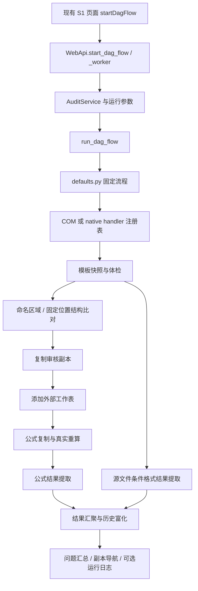
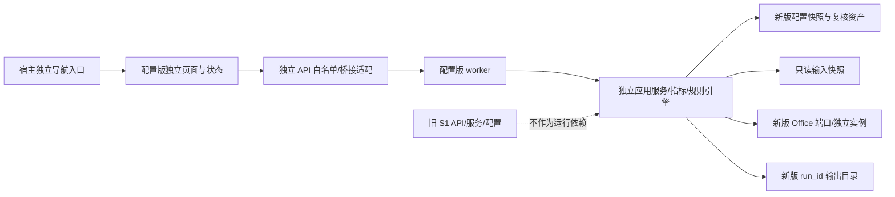

# 逐笔统计系统(配置版)技术架构与实施设计方案

> 状态：研究与设计草案，待用户审阅。日期：2026-10-16。本文中的目录、API、工作簿、界面和阶段均为拟议设计，尚未创建或实施。
>
> 研究基线：`desktop` 分支，HEAD `4ef855574ee41c64ebb39ee9d0c12f099a0e7bd6`，并包含本机已有未提交改动。本文描述的是本次读取到的工作区，不把 HEAD 当作全部研究内容。只读研究代码与测试定义，没有打开真实业务工作簿、运行真实审核或开展性能测试。

## 1. 结论与本轮边界

建议在现有 `core/` 内新增独立的 `configured_transaction_statistics` 业务包，采用“不可变配置快照 → 模板指标目录 → 输入定位 → 规则展开计划 → 取值检查 → Python 动作引擎/Office 兼容执行 → 审核副本与结果”的架构。业务核心保持一套，Windows/Linux 通过新系统自己的平台端口适配。

现有“逐笔统计系统”完整保留。新版不调用旧 `AuditService`、旧 DAG handler、旧 `ExcelSession` 的业务方法，也不把旧公式解析器、旧结果对象或旧历史工作簿作为运行依赖。新版可以学习旧版的流程和用户操作习惯，但必须有自己的业务模型、编译器、规则引擎和存储协议。

三个重要设计决定：

1. **指标身份与物理位置分离。** 指标编号稳定；工作表、命名区域和 A1 坐标属于某一模板版本的定位记录。表头路径或坐标的哈希不能直接充当永久指标身份。
2. **Python 规则与旧 Excel 公式分轨。** Python 只执行明确声明语义的动作和受限表达式，不冒充通用 Excel 计算器；无法证明等价的旧公式进入 Office 兼容执行，保留原公式和依赖。
3. **发布配置与运行状态分离。** 检查、预览和审核均不回写正式配置；历史规则版本保存在不可变快照中；运行结果和人工意见分别保存在新版自己的目录。

本轮仅新增本文及项目要求的修改记录。不修改旧代码、不创建新版业务代码、不改导航、不改配置数据、不更改版本清单、不打包、不提交 Git。文档完成后停止，等待审阅。

## 2. 现有系统架构分析：代码事实

### 2.1 实际结构与职责

以下路径均相对仓库根目录；行号是本轮读取时的定位线索，后续代码变化可能使行号移动。详细证据见附录 A。

| 层次 | 实际文件/入口 | 当前职责与边界 |
| --- | --- | --- |
| 共用前端 | `core/frontend/web/index.html` | S1 导航、文件和目录选择、模板推荐、待处理文件勾选、执行与状态轮询 |
| 共用 API | `core/src/base_audit/web_app.py`，`WebApi.start_dag_flow()`、`_worker()` | 保存页面设置、建立旧 `AuditService`、启动后台任务并分派固定流程；构造器存在配置维护副作用 |
| 平台外壳 | `shell-flask/app.py`；`web_app.py` 的 pywebview 启动入口 | Flask 经 `/api/<method>` 分派；pywebview 暴露桥接对象。两个外壳共用 core |
| 旧 S1 服务 | `service.py`，`AuditService` | 前置检查、汇总、组合工作表、联合模板及历史路径等门面 |
| 文件发现 | `discovery.py`，`source_workbooks()`、`detect_period()`、模板目录索引 | 当前审核输入主要为 `.xlsx`；排除临时文件、审核版、`_skip`/“执行结果”目录；实际推荐/分类路径按工作表集合评分，文件名评分函数当前未接入该路径 |
| 工作流 | `workflow/defaults.py`、`runner.py`、`scheduler.py`、`adapters/` | 代码定义默认 DAG，选择 COM/native 注册表并运行节点；不能把它当作任意配置化业务引擎 |
| 模板协议 | `name_config.py`、`template.py`、`native/openpyxl_workbook.py` | 命名区域、结构化“审核规则”页，及旧模板公式批注规则编号协议 |
| 模板快照 | `template_snapshot.py`，`load_template_snapshot()` | 一次加载模板，抽取规则、区域、结构值、公式文本和矩阵，随后关闭工作簿 |
| 结构比对 | `preflight_xlsx.py`，`validate_source_xlsx()` | 对固定位置的非空模板结构值做类型敏感比对；合并格按锚点读取；当前通过阈值为 0.90，并有最少命中约束 |
| 公式与外部表写入 | `formula_region_writer.py`、`external_sheet_writer.py`、`external.py` | COM/Direct OOXML/openpyxl 写入路径；外部工作表识别有静态正则与全表回退策略 |
| Office | `excel_com.py`、`engines/` | Excel/WPS COM 与 LibreOffice；部分 COM 基础设施和 S1 业务混在 `ExcelSession` 中 |
| 结果与历史 | `models.py`、`history.py`、`native/result_writer.py`、`native/history_io.py` | 问题对象、人工反馈、历史富化、13 列结果表与审核副本跳转 |
| 条件规则 | `cf_reader.py`、`conditional_evaluators.py`、`conditional_engine.py`、`indicator_resolver.py` | 读取/判断条件格式规则或使用 Office 显示效果；旧指标描述由行列文本拼接形成 |

`systems/s1_transaction_statistics/` 目前只有技术债说明 README，不是已经拆分完成的 S1 引擎。[E01–E12]

### 2.2 文件选择和真实调用链

现有前端提供源目录、模板目录、输出目录、逐笔配置、模板、外部文件、逐文件勾选和追加文件。底层检测器能从文件名/目录识别数据期，并返回多期冲突状态；当前WebApi只保存其period字符串，未完整向页面和运行参数传递冲突，执行时空期次还会回退目录名。这是新版必须显式确认/阻断的风险，不应误列为已经完善的可复用交互。模板推荐按工作表集合评分，是辅助识别，不等同于指标语义定位。[E02、E03]



图中条件格式提取可以作为另一分支读取源文件，不应误画成所有情况都在复制公式后执行。代码中的“公式复制并重算”有时合并为一个物理节点，但在新版设计中应分为可独立检查的写入与计算能力。[E04]

### 2.3 模板、公式与结果的当前行为

- 模板可有显式“审核规则”页；也可从“校验区域”的公式单元格读取批注规则编号。无编号时存在以工作表和坐标生成编号的路径。当前 `AuditRule` 将 `sheet_name/formula_cell/target_cell` 与规则绑定；它不是新版要求的语义指标目录。[E05]
- `TemplateSnapshot` 值得借鉴的是“一次读取、关闭句柄、节点间传轻量数据”的思想。其内层映射仍是普通映射对象，不能仅因 dataclass 为 frozen 就认定深层数据已经不可变；新版须对嵌套结构也做冻结。[E06]
- 旧结构比较依赖模板坐标和固定结构标签。0.90 是旧实现的判断条件，不能直接推广为“新版可自动接受 10% 的语义变化”。[E07]
- 旧公式结果可按七槽协议解释：`级别|校验类型|校验指标|描述|当前值|对比值|差值`。辅助公式、最终结果单元格与文本分隔约定共同构成隐含业务协议。新版应拆成结构化字段，迁移时保留旧语义和原文。[E08]
- Windows 的具体主链可使用 COM 或 Direct OOXML 写入，然后保存真实计算结果；native 主链静态写入后调用 LibreOffice。`data_only=True` 只读保存值，本身不是本轮重算证明。[E09]
- 外部引用扫描识别部分 `Sheet!` 文本；仅在完全没有识别到引用时回退全部工作表。静态引用与动态 `INDIRECT` 混用时，这个策略不保证覆盖动态依赖。本文将其登记为新版依赖分析必须避免的风险，不在本轮修改旧实现。[E10]
- native 主链有把历史结果写回所选配置工作簿的路径；当前结果与历史维护不是完全独立存储。平台历史持久化路径也不宜未经核对直接视为等价。[E11]

### 2.4 五项旧能力的保留和新版承接建议

| 现有能力 | 旧版处理 | 配置版首轮建议 | 后续决定 |
| --- | --- | --- | --- |
| S1-F01 汇总核查表校验 | 原入口、业务、配置、结果协议全部保留 | 用独立指标、动作、适用范围和执行计划实现新的审核流程；提供带公式审核副本 | 新规则与旧规则逐项建立迁移账，不能宣称天然等价 |
| S1-F02 汇总校验结果说明 | 保留 | 新版先提供独立审核结果、人工复核和历史关联；不直接调用旧汇总服务 | 是否复刻旧“任意行汇总/说明汇总”输出待确认 |
| S1-F03 组合工作表（核查表） | 保留 | 可以读取用户已生成的联合工作簿，按文件契约进入新版 | 新版是否独立提供组合能力待确认 |
| S1-F04 组合工作表（按配置） | 保留 | 不复用旧固定 DAG 或组合配置作为新版规则引擎 | 如需要，另设新版独立组合动作和配置 |
| S1-F05 制作联合模板 | 保留 | 新版接受独立选定的基准模板；目录生成器只分析、不修改模板 | 如需制作模板工具，单独设计，不调用旧内部服务 |
| 旧条件格式审核 | 旧流程保留 | 可将支持的规则导出为迁移候选；新版优先使用显式判定动作 | 是否要求原生显示颜色完全一致需单独确认和真机验收 |

这张表不表示删减旧能力。新系统首版范围建议聚焦独立审核主链；若用户要求配置版一开始覆盖全部五项能力，需要扩大后续实施阶段。

### 2.5 可借鉴与可复用的分界

| 对象 | 结论 | 采用方式 |
| --- | --- | --- |
| 文件勾选、模板推荐提示、进度/取消、打开输出、复制日志 | 借鉴交互 | 新页面有自己的状态、事件与 API；不复用旧页面全局变量 |
| 一次解析模板、批量读取、输入只读、先依赖后公式、保留审核副本 | 借鉴设计 | 在新版实现独立模型和流程 |
| Python 标准库、openpyxl 公共 API、经过验证的 lxml 用法 | 可直接使用 | 锁定兼容依赖版本；不宣称 lxml 负责计算公式 |
| 受控文件对话框、打开路径等宿主基础动作 | 有条件复用 | 先核对无旧配置初始化/写入副作用，以窄接口调用并加契约测试 |
| `engines/protocol.py` 的能力形状 | 可参考 | 定义新版自己的 `CalculationReceipt`；不假定现有返回对象具备缓存新鲜度证明 |
| `ExcelWpsCalculator`、旧 `ExcelSession` | 不直接依赖 | 当前包装器仍进入混合职责的旧会话；新版平台适配器直接使用公开 COM/UNO/进程接口 |
| `FormulaRegionWriter`、`ExternalSheetWriter` | 技术参考，不直接作为新版业务接口 | 当前存在旧模板对象、旧“审核规则”页及支持范围约束；新版按自己的契约实现和验收 |
| `AuditService`、旧 DAG/handler、旧 `AuditRule/Issue`、旧配置初始化/历史函数 | 禁止成为新版运行依赖 | 不为复用它们重构、搬迁或抽取旧业务代码 |
| S2/S3 业务引擎及表达式模块 | 不直接依赖 | 只经显式版本化文件交换接入，避免绑住它们的内部数据模型 |

## 3. 需求澄清与建议默认值

### 3.1 已确认要求

1. 旧版保留，新版入口名称为“逐笔统计系统(配置版)”，导航、业务代码、引擎、配置和输出独立。
2. Python 为主，Excel 工作簿配置驱动；基准模板命名区域框定结构，生成指标目录和定位明细。
3. 指标身份与坐标分开；支持多行多列表头路径；结构变化先提示，由人工确认后发布映射。
4. 规则动作库与适用范围分离并支持多对多关系；不用逗号拼接大量 ID；批量选择须能展开、筛选、追溯。
5. 正式执行前检查取值有效性；不能静默丢规则；区分取数失败、计算失败与审核触发。
6. 生成保留 Excel 公式的审核副本和可跳转清单，保留人工复核、反馈及历史体验。
7. 研究 Office 重算和缓存写入风险；对旧公式提供迁移辅助和结果比较，覆盖 IF/AND/OR、算术、跨表、INDIRECT、拼接和辅助单元格依赖。
8. 第一阶段只研究并写完整 Markdown 方案，不进入开发。

### 3.2 本文采用的设计默认值，尚非用户批准的业务口径

| 项目 | 建议默认值 | 原因/待确认点 |
| --- | --- | --- |
| 首版输入 | `.xlsx` 固定统计表/有限结构位移的网格 | 现有路径主要处理此类文件；真正逐交易明细表需要记录主键，见第 9 节 |
| 新版首版功能 | 独立审核主链、结果、公式副本、人工复核 | 是否同时覆盖旧五项功能尚未确认 |
| Python 主路径 | 版本化动作库与受限、带类型表达式 | 避免重写不完整 Excel 引擎 |
| 旧复杂公式 | Office 兼容执行，原公式及依赖闭包保留 | 自动迁移只覆盖能验证等价的子集 |
| 未识别结构/重复定位 | 阻断受影响文件的正式运行，给候选和差异 | 不按相似率自动猜测映射 |
| 错误策略 | 配置错误阻断整个正式计划；输入错误允许诊断其他文件，但总状态不显示完整成功 | 不能产出看似完整的审核结果 |
| 历史人工意见 | 独立复核工作簿/事件存储，不写入规则配置 | 配置发布不覆盖人工资产 |
| 跨系统审核 | 用户选择的只读文件快照与显式数据契约 | 不直接调用 S2/S3 内部引擎 |
| 金额数值 | 原始值保留；受控 Decimal 口径；单位、舍入和比较容差显式配置 | 与 Excel 浮点口径差异须作为迁移对拍项 |
| 文件修改 | 原始文件不改，正式配置不自动改；候选和审核副本写入新版目录 | 可回滚、可复核 |

待确认问题集中放在第 17 节；本轮不要求先回答才能阅读方案。

## 4. 新旧系统隔离方案

### 4.1 业务、配置和接口边界

建议使用逻辑系统键 `configured_transaction_statistics`。展示名称固定；组件编号暂不写入 VERSION_MANIFEST，待确认它作为 S1 独立子系统还是新的系统编号。不要自行占用 S4 或复用 S1-F01 的编号和版本。

拟议目录如下，**本轮不创建**：

```text
core/src/base_audit/systems/configured_transaction_statistics/
  domain/          身份、值、规则、结果等独立不可变模型
  configuration/   读取、校验、配置发布协议与快照
  catalog/         命名区域、表头树、指标目录、定位、结构差异
  rules/           动作注册、语法、IR、展开、取数计划、执行状态
  application/     use case、任务状态、取消与结果编排
  ports/           文件、Office、输出、时钟、复核存储接口
  adapters/        本系统的 xlsx/JSON/复核存储适配
  migration/       旧公式只读提取、AST、依赖、候选、对拍
  worker.py        独立工作进程入口
core/src/base_audit/native/configured_transaction/  配置版专用平台适配：Excel/WPS/Calc
core/frontend/configured-transaction/       独立页面资源与状态
core/tests/configured_transaction/          独立测试，不借用旧业务 fixture 的隐含协议
```

业务仍只在 `core/` 实现一次；两种 shell 仅负责导航接入、文件对话框和进程/接口转发。新版平台适配器放在 `native/configured_transaction/` 专属命名空间，直接实现新版 ports；系统包中的 adapters 负责非平台文件/存储适配。此处不复用旧 `engines/__init__.py` 的引擎注册和探测，不修改旧会话或旧包初始化，也不让新业务代码出现 COM/UNO 判断。当前 `base_audit`/`native` 包初始化没有旧业务初始化调用；未来必须用导入边界测试持续验证，不能靠目录名称推断隔离。

未来接入点只允许小范围增加：独立导航项、页面资源挂载、独立 API 白名单及新 worker 启动参数处理。现有 S1 的按钮、路由、默认参数和业务函数保持原语义；这一点靠 diff 审查和回归证明，而非口头承诺。

### 4.2 推荐采用独立工作进程

独立 worker 不导入 `web_app.py`、旧服务、旧 handler、旧配置初始化或旧 Office 会话。配置读取、审核、Office 重算、取消和异常终止均由它持有资源。宿主只提交经过校验的运行请求并接收事件。



图中虚线表示禁止依赖，不是建议调用。进程隔离用于避免旧全局设置、Office 状态、取消标志和任务结果混用；它不等同于操作系统级沙箱。通过路径访问控制和导入约束继续限制文件读写。

拟议 API 使用 `configured_transaction_*` 明确方法名或独立 `/api/configured-transaction/...` 路径：检查配置、生成目录候选、比较结构、预览展开、开始运行、读取状态、取消、打开结果。Flask为新路由建立显式方法白名单和独立worker客户端，不通过当前 `/api/<method>` 的通用反射分派接入；pywebview使用只暴露新版窄接口的桥接对象/适配层，不把业务方法直接塞进旧WebApi。宿主旧入口保留其原行为。新接口不接受Python代码、shell命令或未限制路径。

### 4.3 必须说明的启动隔离限制

当前 `WebApi` 构造时会加载/可能回写旧用户设置，并调用旧 S1 历史初始化及 S2 配置维护。[E12] 因此：

- “新版任务从启动到结束不读写旧配置”可通过独立 worker、独立配置和路径守卫验证。
- “从打开整个现有程序开始，旧配置绝不被既有启动逻辑触碰”不能仅靠加新页面保证；这属于已有启动流程行为。
- 若第二条也是硬要求，需批准一个独立配置版启动入口，在导入旧 `WebApi` 之前进入新版 worker/页面；它与导航入口访问同一套新版业务代码。另一方案是以后调整宿主为惰性初始化旧系统，但会改变旧启动时序，本方案不将这种旧版重构作为前置条件。

推荐首版同时设计独立 worker 和可独立启动路径：在旧宿主中提供导航入口；严格隔离验收使用独立启动路径。旧宿主的既有副作用必须单列基线，不能把“历史就有的写入”混称为新版零影响，也不能为了保证而在本轮改旧初始化代码。

### 4.4 文件与运行资产隔离

| 资产 | 新版拟议位置/规则 | 旧资产保护 |
| --- | --- | --- |
| 公开默认配置 | `config/逐笔统计配置版/` 下仅空表头/虚构示例 | 不替换旧 `1.逐笔统计系统_配置.xlsx` 或其默认快照 |
| 本机维护配置 | `config-real/逐笔统计配置版/`（开发）或用户选择的新版工作区（部署） | 不继承旧 history_config 路径；不自动“发现并升级”旧文件 |
| 已发布配置 | 新版工作区 `versions/<config_id>/<revision>/` | 不可变快照；安装/升级只更新程序自带 defaults，不覆盖用户配置 |
| 用户设置与缓存 | 独立用户数据目录 `configured-transaction/` | 不写旧 `data/用户设置.json`、旧模板索引或旧配置绑定 |
| 运行输出 | 用户输出根目录下 `逐笔统计配置版/<run_id>/` | 每次唯一目录；拒绝与原文件同路径，避免旧输出命名冲突 |
| 人工复核/历史 | 新版工作区 `review/`、`history/` | 不使用旧“核查表校验结果”Sheet，不写回旧配置册 |
| 临时文件 | 新版私有临时目录，按 run_id 隔离 | 只清理自己登记的路径/进程；不扫描删除旧资产 |

用户数据目录由 Windows 用户应用数据目录、Linux XDG 用户目录或显式工作区解析；不依赖当前工作目录，也不要求普通用户写 `/opt`。配置版本、规则版本、程序版本分别管理；本轮纯文档不升级任何组件。

### 4.5 可以验收的零影响约束

1. 新版业务包不得导入旧 `service/excel_com/name_config/template/history` 或旧 DAG handler；CI 检查直接和传递导入边界。
2. 运行前冻结并散列新版输入、模板、配置；记录旧代码、旧配置、旧设置的基线摘要。独立启动验收从新进程启动前取基线；既有宿主集成验收在旧WebApi初始化完成后取“新版任务基线”，并另外报告宿主启动阶段既有写入。新任务结束后与对应基线比较，不能混淆两个时点。
3. 新 worker 的写入路径必须全部位于明确授权的新版输出、用户数据或临时目录；解析符号链接后的真实路径也检查，不能只按字符串前缀判断。
4. 新旧任务、取消、日志、最近路径、默认配置恢复按钮分别命名和存储；新版重置只操作新版路径。
5. 在旧功能五项回归之外，验证新系统不启用/启用/失败/取消/退出/升级/卸载各场景。程序退出不得关闭用户已有 Office。
6. 运行新版前后的哈希不变只证明本次文件未改，不能替代旧功能行为对拍；两类验收都需要。
7. 新功能不得顺手升级旧版使用的Python/openpyxl等公共依赖。若新版确需不兼容依赖，先评估独立worker运行时/发行依赖隔离并单独批准，不能用“业务进程独立”掩盖共享依赖改变旧功能的风险。

## 5. 候选架构比较与推荐

| 候选 | 优点 | 主要问题 | 结论 |
| --- | --- | --- | --- |
| 在旧 S1 上加配置开关并继续调用旧引擎 | 初期代码量小 | 不满足独立引擎；旧模板/历史语义和新语义互相影响 | 排除 |
| 复制全部旧代码再改名 | 容易获得初始外观 | 复制混合职责、隐含协议和问题，产生两份难以维护的旧引擎 | 排除；允许参考流程，不整包克隆 |
| 所有规则继续写 Excel 公式，Python 仅负责搬运 | 旧公式兼容性高 | 配置本质仍是坐标公式；Office 重依赖，执行状态和可审计性不足 | 仅作为兼容执行后端 |
| 全面实现 Python Excel 公式引擎 | 理论上减少 Office 依赖 | Excel 函数、强制类型、错误传播、动态引用、循环计算等难以完整等价，违反项目计算边界 | 排除 |
| 独立模块化核心 + 带类型规则 IR + Python 动作引擎 + Office 兼容后端 | 主要审核由 Python 完成；可展开、检查、追溯；复杂历史公式有保留路径 | 需要明确语义、版本和迁移对拍，实施不是一次性改名 | **推荐** |

推荐在逻辑上使用模块化单体，在运行上用独立 worker 隔离。先不引入数据库服务器、消息队列或远程微服务；配置文件是人工维护入口，内存索引是执行结构，SQLite 等仅可作为未来本地可重建运行索引，不能悄悄变成第二套规则真相。

静态读取优先 Python/openpyxl；只在范围明确、保真验证充分且测得瓶颈时做 Direct OOXML 优化。lxml 是 XML 实现选择，不能代替 Office 重算；首版不因优化引入新的必需编译依赖。不要在未测量前承诺多少倍提速。

## 6. 核心领域对象与运行流程

新版独立定义以下对象，不继承旧 `AuditRule` 或 `Issue`：

| 对象 | 核心内容 | 不应持有的内容 |
| --- | --- | --- |
| `ConfigSnapshot` | 配置 ID/修订/格式版本、文件摘要、不可变表、动作版本 | 活动 Workbook、可变全局设置 |
| `TemplateCatalogSnapshot` | 模板版本、区域、表头树、指标、定位与结构摘要 | Office 实例、长期文件句柄 |
| `InputManifest` | 文件角色、来源 ID、文件哈希、期次/机构、选择与排除原因 | 从文件名猜出后未确认的业务身份 |
| `Observation` | 指标/记录身份、原值/类型、规范值、单位、取数位置、取值状态 | 把缺失/错误默认成 0 的伪数值 |
| `CompiledRule` | 动作版本、AST/IR、参数类型、适用范围、取数绑定和依赖 | 动态执行的 Python/shell 文本 |
| `RuleInstance` | 规则修订、目标身份、机构/期次/维度、唯一实例键、全部操作数 | 只有坐标而无语义身份的“目标” |
| `RuleResult` | 执行状态、业务判定、数值过程、证据、输出位置 | 用是否有提示字符串推断成功 |
| `CalculationReceipt` | 引擎/版本、输入/输出摘要、计算范围、完成状态、错误值和时间 | 仅以修改时间充当重算证明 |
| `ReviewEvent` | 问题语义键、用户反馈/意见、关联运行、修订与冲突 | 自动覆盖旧人工意见的最后一次文本 |

运行流程固定为：

```text
选择配置/模板/输入并确认身份
  → 只读配置与模板检查
  → 按已批准模板版本定位，输出结构差异
  → 编译规则与依赖，生成完整展开预览
  → 人工接受计划（结构变化必须另有确认）
  → 冻结文件快照和 plan_hash，再次校验版本未变
  → 分阶段批量取值与有效性检查
  → Python 动作执行 / Office 兼容执行
  → 生成带公式的审核副本、可跳转结果、执行总账
  → 可选 Office 镜像复算与差异比较
  → 原子发布本次输出，进入人工复核
```

“人工接受计划”可对完全相同且未变化的已批准计划复用确认记录，但必须校验模板、配置、范围和输入结构哈希；数据内容变动仍生成新的运行快照。审核中途文件或配置变化时使计划失效，不能继续用旧预览运行新文件。

## 7. 配置工作簿完整设计

### 7.1 配置包和人工维护负担

推荐一个**主规则工作簿**，配一个生成的**模板指标目录工作簿**。两者连同基准模板/兼容公式资源形成一个有完整清单和 SHA-256 的配置包。主册管理规则、范围、参数和版本索引；目录册保存大量生成的结构信息。这样避免把数万个定位行和日常维护规则混在一起，也避免主册、目录册各自维护同一指标的两套真相。

拟议文件名：`逐笔统计配置版_规则配置.xlsx`、`逐笔统计配置版_模板指标目录.xlsx`。用户日常主要维护“规则清单、动作参数、范围成员/范围条件、规则适用范围、取数绑定”。其他页由生成/发布工具或高级维护操作管理。迁移候选册、审核结果册、人工复核册独立，均不是正式规则来源。

如最终要求只分发一个物理文件，可以把整个配置包封装成单个归档，打开时校验后加载其中 Excel；不得把一个 Excel 路径单独移动后悄悄改用其他目录版本。若坚持所有表都放在一个 Excel，可保留相同逻辑表结构，但目录与规则的版本绑定仍必须明确。

### 7.2 通用格式与字段规则

- 业务表第 1 行为固定表头，第 2 行起为记录；说明置于独立“使用说明”页及表头批注，不靠猜测任意行寻找新格式表头。
- 单元格类型记号：`ID`=精确文本键，`T`=文本，`I`=整数，`D`=十进制文本数，`B`=是/否，`E`=枚举，`X`=受限表达式文本，`H`=64 位十六进制 SHA-256，`DT`=带时区时间文本。`!` 必填，`?` 可空，`=...` 表示固定默认值。ID/信用代码/长编码一律按文本读写。
- 主键、外键、启停、取数位置和表达式不能来自未重算的 Excel 公式单元格；配置的表达式列是以文本存储的 DSL，不是在配置册中运行的 Excel 公式。
- 一个关系一行。`I001,I002,I003`、`I001、I002` 或换行塞多个 ID 均非法；逗号可以合法出现在公式语法或普通说明里，但不能作为关系字段编码。
- 大小写、空格标准化按字段类型规定：ID 精确匹配，不自动修正 ID；用户标签可按明确策略 trim，保留原文。数字 0、空串、空白格、布尔值和错误值分别处理。
- 列名/枚举/必填字段错误必须带工作簿、Sheet、Excel 行、字段及对象编号。未知非空业务列默认报错；弃用列须由格式版本明确声明，不静默忽略。
- 下列字段集是建议的首个正式协议；启用尚未实现的表、动作或枚举时检查器须明确失败，不能先接受配置以后再漏跑。
- 期次字段按频度采用明确的ISO年月/日期等协议；同一上下文内格式唯一，跨频度比较必须有专门转换/聚合规则。生效区间端点包含在内，空端点表示无界；同键有效区间重叠造成多义时拒绝发布。

### 7.3 主规则工作簿：元信息、动作和规则

每个编号代表一个独立 Sheet。“使用说明”只作说明，不参与执行。

| Sheet | 完整字段（含类型/必填性） | 主键与语义 |
| --- | --- | --- |
| M01 配置属性 | `键:T!`；`值:T!`；`类型:E!` | PK=键；固定键见下表。类型只能用于校验，不能更改字段契约 |
| M02 数据源 | `数据源ID:ID!`；`名称:T!`；`角色:E!`；`形态:E!`；`契约版本:T!`；`模板版本ID:ID?`；`值策略ID:ID!`；`必需:B=是`；`文件名提示:T?` | PK=数据源ID。角色=CURRENT/PREVIOUS/EXTERNAL/S2_EXPORT/S3_EXPORT；形态=GRID/LONG_TABLE。文件实际位置由本次选择清单绑定；文件名提示不决定身份 |
| M03 动作库 | `动作ID:ID!`；`动作版本:T!`；`动作类型:E!`；`后端:E!`；`参数协议摘要:H!`；`输出协议版本:T!`；`说明:T!` | PK=(动作ID,动作版本)。后端=PYTHON/OFFICE_COMPAT；由代码中的明确注册表生成可用清单，发布时核对；不是在 Excel 中声明任意 Python 函数 |
| M04 规则清单 | `规则ID:ID!`；`修订:I!`；`名称:T!`；`动作ID:ID!`；`动作版本:T!`；`级别:E!`；`前提表达式:X?`；`比较策略ID:ID?`；`输出策略ID:ID!`；`说明模板:T!`；`目标最少数:I=1`；`目标最多数:I?`；`生效起期:T?`；`生效止期:T?`；`启用:B=是` | PK=(规则ID,修订)，同一配置同规则仅一个启用修订。COMPARE/SUM_BALANCE及注册协议要求的比较动作必须填写比较策略；其他动作不得填写无效的多余策略。级别=错误/核实/提示；最少/最多在每个声明上下文检查 |
| M05 动作参数 | `规则ID:ID!`；`规则修订:I!`；`参数名:ID!`；`参数类型:E!`；`参数值:T!` | PK=(规则ID,规则修订,参数名)。类型来自动作参数协议，允许 TEXT/DECIMAL/INTEGER/BOOLEAN/EXPR/COMPAT_ENTRY_ID 等标量；不得放多 ID 列表。未知参数和多余参数报错 |

M01 固定键如下，不能缺省为旧 S1 设置：

| 键 | 类型/约束 | 含义 |
| --- | --- | --- |
| format_version | T，例如 `configured-rules-1` | 工作簿结构协议；未知版本阻断 |
| config_id | ID | 配置包稳定编号 |
| revision | I，正整数 | 整份规则配置修订 |
| status | E：DRAFT/PUBLISHED | 正式运行只接受已校验发布的快照 |
| dsl_version | T，例如 `typed-rule-1` | 运算、空值、类型及错误语义版本 |
| catalog_file | T，安全相对路径 | 唯一目录册相对位置；不得路径越界 |
| catalog_sha256 | H | 本修订锁定的目录册文件摘要 |
| default_value_policy_id | ID | 未单独指定时的值策略 |
| default_output_policy_id | ID | 未单独指定时的输出策略 |
| failure_policy | E，建议 `BLOCK_FORMAL_RUN` | 出错不标完整成功；诊断模式必须另行显示 |
| created_at / published_at | DT；后者发布时必填 | 候选生成和发布时刻，不代替文件哈希 |
| parent_revision | I? | 上一版修订；完整快照由版本存储保存 |

### 7.4 主规则工作簿：范围和多对多关系

| Sheet | 完整字段 | 主键与约束 |
| --- | --- | --- |
| M06 适用范围 | `范围ID:ID!`；`修订:I!`；`名称:T!`；`模式:E!`；`最少匹配数:I=1`；`最多匹配数:I?`；`零匹配处理:E=ERROR`；`启用:B=是` | PK=(范围ID,修订)。模式=EXPLICIT/FILTER/MIXED/ALL；ALL 必须显式选择并确认展开数。零匹配仅可 ERROR/NOT_APPLICABLE，后者必须在预览显示原因 |
| M07 范围组 | `范围ID:ID!`；`范围修订:I!`；`组ID:ID!`；`作用:E!` | PK=(范围ID,范围修订,组ID)。作用=INCLUDE/EXCLUDE；同组条件 AND，不同组 OR |
| M08 范围条件 | `范围ID:ID!`；`范围修订:I!`；`组ID:ID!`；`序号:I!`；`字段:E!`；`运算符:E!`；`值类型:E!`；`条件值:T!`；`区分大小写:B=是` | PK=组键+序号。字段来自白名单：模板/表格/工作表/指标ID、表头祖先、指标维度等。运算符=EQ/PREFIX/CONTAINS/REGEX；复杂正则受资源限制。集合不编码到单格 |
| M09 范围成员 | `范围ID:ID!`；`范围修订:I!`；`指标ID:ID!`；`作用:E!` | PK=(范围ID,范围修订,指标ID,作用)。每行一个指标；EXCLUDE 优先于本范围 INCLUDE |
| M10 规则适用范围 | `规则ID:ID!`；`规则修订:I!`；`范围ID:ID!`；`范围修订:I!`；`关系:E!`；`启用:B=是` | PK=规则键+范围键+关系。关系=INCLUDE_TARGET/EXCLUDE_TARGET；形成规则与范围多对多关系 |

范围求值公式：

```text
单个范围 = (显式 INCLUDE 成员 ∪ 命中 INCLUDE 条件组的指标) − 本范围所有 EXCLUDE
规则目标 = 所有关联 INCLUDE_TARGET 范围的并集 − 所有 EXCLUDE_TARGET 范围的并集
```

ALL 模式的初始集合是该配置锁定目录内、当前数据源上下文的全部有效指标，不跨机构/期次；其他模式缺少包含条件时集合为空，不默认为全部。并集按指标身份去重，一个目标被多个包含范围命中不重复运行，但“命中来源”保留多行供追溯。一个范围内部的排除不代表全规则排除；若要全规则排除，必须使用 EXCLUDE_TARGET 关系。

批量匹配是“条件生成匹配集合”，不是让维护者复制几千个 ID 到一个格子。预览允许按规则、来源范围、工作表、指标路径、维度和匹配原因筛选；需要固化时输出一行一关系的成员候选，由用户审核发布。

### 7.5 主规则工作簿：取数、关联和值语义

| Sheet | 完整字段 | 主键与语义 |
| --- | --- | --- |
| M11 取数绑定 | `规则ID:ID!`；`规则修订:I!`；`变量名:ID!`；`数据源ID:ID!`；`选择方式:E!`；`指标ID:ID?`；`范围ID:ID?`；`范围修订:I?`；`关联方案ID:ID!`；`基数:E!`；`聚合:E=NONE`；`值策略ID:ID!`；`目标单位:T?` | PK=规则键+变量名。选择方式=INDICATOR/SCOPE/SAME_TARGET；前两者相应 ID 必填且互斥；SAME_TARGET 不填两个选择列。基数=ONE/SET；SET 必须显式 SUM/COUNT/MIN/MAX 等已支持聚合，禁止隐式求和 |
| M12 关联方案 | `关联方案ID:ID!`；`名称:T!`；`左粒度:E!`；`右粒度:E!`；`关系:E!`；`缺键处理:E=ERROR` | PK=关联方案ID。关系=ONE_TO_ONE/MANY_TO_ONE/EXPLICIT_AGGREGATION；左/右粒度包括法人、报送主体、地区、交易记录等，不可混淆 |
| M13 关联字段 | `关联方案ID:ID!`；`顺序:I!`；`目标字段:ID!`；`来源字段:ID!`；`标准化:E=EXACT`；`身份映射集ID:ID?` | PK=(关联方案ID,顺序)。多列关联键由多行组成。标准化仅 EXACT/TRIM/APPROVED_MAPPING 等白名单；不擅自截取信用代码/机构代码 |
| M14 值策略 | `策略ID:ID!`；`数据类型:E!`；`空值处理:E!`；`数字文本处理:E!`；`错误值处理:E=ERROR`；`数值区域设置:E!`；`百分数表示:E?`；`日期规则:E?`；`公式值来源:E=RECALCULATED_ONLY` | PK=策略ID。类型=DECIMAL/INTEGER/TEXT/CODE/DATE/BOOLEAN。空值=ERROR/NOT_APPLICABLE/EXPLICIT_ZERO，零值替代必须明确业务批准；公式输入不凭旧缓存直接通过 |
| M15 比较策略 | `策略ID:ID!`；`方法:E!`；`绝对业务容差:D=0`；`相对业务容差:D=0`；`数值误差上限:D=0`；`比较前小数位:I?`；`舍入:E!`；`零分母处理:E=ERROR` | PK=策略ID。方法=ABS/REL/ABS_OR_REL；业务允许差异与计算误差分别记录；舍入=NONE/HALF_UP/HALF_EVEN 等批准值。不能在读数时为凑结果先舍入 |
| M16 单位换算 | `来源单位:T!`；`目标单位:T!`；`数据属性:E!`；`系数:D!`；`偏移:D=0`；`生效起期:T?`；`生效止期:T?` | PK=来源/目标/属性/生效起期。公式固定为 value×系数+偏移；缺换算、冲突周期或多跳歧义报错。编码/文本不允许数值换算 |
| M17 身份映射 | `映射集ID:ID!`；`类型:E!`；`来源系统:T!`；`来源键:T!`；`标准身份:T!`；`标准粒度:E!`；`生效起期:T?`；`生效止期:T?`；`确认记录ID:ID!` | PK=映射集/类型/来源系统/来源键/生效起期。类型=REPORTING_ORG/LEGAL_ENTITY/INDICATOR/REGION 等明确枚举；一对多不得靠重复行形成隐式笛卡尔积 |
| M21 数据源上下文 | `数据源ID:ID!`；`字段名:ID!`；`字段类型:E!`；`取值方式:E!`；`常量:T?`；`指标ID:ID?`；`值策略ID:ID!` | PK=数据源ID+字段名。取值方式=MANIFEST/CONSTANT/INDICATOR，互斥填写；用来明确机构、期次、币种、频度、批次、记录键等字段来自用户确认清单、常量还是指定指标/记录列，不能隐式从文件名推断 |

补充语义：

- 值策略的生效层次必须明确：已映射指标按 C07 策略解析，上下文字段按 M21 策略解析；未映射的一般数据才使用 M02、再使用 M01 的默认策略。M11 策略只对已解析值增加绑定级校验，不能覆盖上游错误、重新解释类型或放宽为空转零；单位转换单独记录。不同层声明不兼容时在配置检查中报冲突，不按最后出现的一列偷偷覆盖。
- `变量名`仅在当前规则作用域内有效；动作表达式中的 `$A` 引用取数绑定 A，`target.value` 引用当前目标值。不会按名称查找全工作簿里“差不多的值”。
- 取数绑定的必需值在动作计算前全部校验。首版不接受“缺值但可能落入不执行的 IF 分支，所以暂时当成功”；需要条件依赖时必须升级显式依赖语义并完成分支测试，或保留 Office 兼容执行。
- ONE 为 0 个/多个都失败；SET 的每个成员仍需有效，空集合不自动等于 0。空集合求和等业务例外只有明确策略才能开启。
- 相对差异分母、绝对值、零值语义由动作版本和比较策略明确规定。百分数的 `9.92` 表示 9.92% 还是 9.92 倍必须声明；百分点差异与相对变化率是不同动作。
- 社会信用代码表示法人身份时不能直接当作每家分支或报送主体的唯一键。外部数据是法人总行口径、源表是分支口径时，必须有粒度映射/聚合方案并人工确认。
- M13 的字段只能引用已声明的 M21 上下文字段、目录中的指标维度或有类型的运行内置字段；字段引用使用 `context.*`、`indicator.dimension.*`、`record_key.*` 等固定命名空间。LONG_TABLE 的上下文可按记录行取值。C03 的记录键方案引用 M12/M13，在该源自身行粒度使用其字段组成唯一键，必须非空且唯一；不能拿行号当稳定交易记录身份。

首版枚举补充，避免由实现者临时猜测：

| 字段 | 允许值与约束 |
| --- | --- |
| M14 数字文本处理 | REJECT / ALLOW_EXACT_PARSE；后者按声明区域设置严格解析，不删除任意非数字字符 |
| M14 数值区域设置 | DECIMAL_DOT / DECIMAL_COMMA；千分位只允许各自协议的合法分组，不猜测混合格式 |
| M14 百分数表示 | FRACTION / PERCENT_100 / NOT_APPLICABLE；百分比数据必选前两者之一 |
| M14 日期规则 | ISO_DATE / EXCEL_SERIAL_1900 / EXCEL_SERIAL_1904 / NOT_APPLICABLE；按已识别工作簿日期系统交叉验证 |
| M14 公式值来源、错误值处理 | 首版分别仅接受 RECALCULATED_ONLY、ERROR；直接字面值不需要Office，公式值需本轮计算证据，不允许错误转0 |
| M12 左/右粒度 | FILE / REPORTING_ORG_PERIOD / LEGAL_ENTITY_PERIOD / REGION_PERIOD / DETAIL_RECORD；字段组成必须匹配声明粒度 |
| M12 缺键处理 | 首版仅 ERROR；不适用应由显式范围/前提语义表达 |
| M15 零分母处理 | ERROR / NOT_APPLICABLE；只有动作实际涉及分母时才适用，不允许自动制造无穷或改算绝对值 |
| M17 类型、标准粒度 | 类型仅 REPORTING_ORG / LEGAL_ENTITY / INDICATOR / REGION；标准粒度与映射类型/关联方案一致，不接受自由文字冒充粒度 |
| C02 可见性 | VISIBLE / HIDDEN / VERY_HIDDEN；原样记录，不以隐藏状态推断不需要依赖 |

M02形态GRID对应C03布局GRID；LONG_TABLE对应DETAIL_TABLE。M14数据类型、M15方法/舍入、M21取值方式及其他枚举按各自字段表中的集合执行，未列出的值均报错。DECIMAL配置推荐以文本维护；若首版允许Excel数值格，应按其OOXML实际数值词法读取并展示，而不是试图恢复Excel录入时已经丢失的精度，具体选择在Q07确认。

### 7.6 主规则工作簿：输出、版本和人工确认

| Sheet | 完整字段 | 主键与语义 |
| --- | --- | --- |
| M18 输出策略 | `策略ID:ID!`；`输出通过项:B=否`；`输出不适用项:B=是`；`生成公式副本:B=是`；`公式复算:E!`；`原生显示核验:B=否`；`副本表名前缀:T!`；`结果模板版本:T!` | PK=策略ID。公式复算=DEFERRED/REQUIRED；LEGACY_OFFICE 规则不允许 DEFERRED 取得正式结果。无论结果是否展示通过项，执行总账始终保留全部计划条目 |
| M19 版本记录 | `配置ID:ID!`；`修订:I!`；`父修订:I?`；`目录摘要:H!`；`规则内容摘要:H!`；`发布时间:DT!`；`发布人:T!`；`变更摘要:T!`；`快照相对位置:T!` | PK=(配置ID,修订)。完整历史保存在外部不可变快照，本表是索引。自文件哈希不写回自身单元格，避免自引用哈希悖论；整文件摘要保存在配置包清单 |
| M20 结构确认 | `确认记录ID:ID!`；`对象类型:E!`；`旧对象摘要:H?`；`新对象摘要:H!`；`差异清单摘要:H!`；`决定:E!`；`确认人:T!`；`确认时间:DT!`；`确认说明:T!` | PK=确认记录ID。对象=STRUCTURE/ALIAS/IDENTITY_MAP；决定=APPROVED/REJECTED。确认绑定具体差异，不是可复用的“全部同意”标志 |

发布顺序：编辑草稿 → 只读检查 → 展开/结构差异预览 → 明确确认 → 输出新的完整发布快照与清单。生成器不覆写现有已发布文件。用户用 Excel 手工编辑已发布文件后摘要不匹配，应提示“已成为草稿”，重新发布，不能仍冒充原修订。

版本记录页不能保存整份旧规则到单元格；旧版本必须能按修订独立恢复并重放。版本目录采用临时目录写完、校验、原子提交；并发发布使用锁和期望父修订检查。回滚是选择已有历史修订进行新运行，不修改旧运行证据，也不覆盖人工意见。

### 7.7 模板指标目录工作簿：生成字段

目录册由模板分析生成候选，人工批准后成为配置快照的一部分；不是程序运行时随手更新的缓存。目录里不复制源文件业务数据值。

| Sheet | 完整字段 | 主键与规则 |
| --- | --- | --- |
| C01 模板版本 | `模板版本ID:ID!`；`模板ID:ID!`；`版本标签:T!`；`模板文件提示:T!`；`模板SHA256:H!`；`目录生成协议:T!`；`状态:E!`；`确认记录ID:ID?` | PK=模板版本ID。状态=CANDIDATE/APPROVED/RETIRED；正式配置只引用 APPROVED；文件名不是版本身份 |
| C02 工作表版本 | `工作表版本ID:ID!`；`模板版本ID:ID!`；`工作表语义ID:ID!`；`实际表名:T!`；`必需:B=是`；`可见性:E!` | PK=工作表版本ID。实际名称与语义身份分开；同模板中大小写折叠后重名/歧义拒绝 |
| C03 表格版本 | `表格版本ID:ID!`；`工作表版本ID:ID!`；`表格语义ID:ID!`；`布局:E!`；`记录键方案ID:ID?`；`数据起始行:I?`；`终止方式:E?`；`终止字段指标ID:ID?`；`最大数据行:I?`；`结构摘要:H!` | PK=表格版本ID。布局=GRID/DETAIL_TABLE；后者必须有记录键、起始行和有限最大行。终止方式=FINITE_AREA/KEY_BLANK；后者必填终止字段，且发现终止点后仍有疑似记录时必须报边界异常。首版仅支持FINITE_AREA时拒绝KEY_BLANK |
| C04 区域定义 | `区域版本ID:ID!`；`表格版本ID:ID!`；`区域语义ID:ID!`；`用途:E!`；`命名区域:T!`；`名称作用域:E!`；`必需:B=是` | PK=区域版本ID。用途=ROW_HEADER/COLUMN_HEADER/DATA/STRUCTURE/AUXILIARY；作用域=WORKBOOK/SHEET，后者限本工作表 |
| C05 区域子区 | `区域版本ID:ID!`；`子区序号:I!`；`地址:T!`；`锚点:T!`；`形状摘要:H!` | PK=区域版本ID+序号。一个有限矩形一行；命名区域多面积引用必须展开，不能用逗号塞地址 |
| C06 表头节点 | `节点ID:ID!`；`表格版本ID:ID!`；`轴:E!`；`父节点ID:ID?`；`层级:I!`；`原始文本:T!`；`规范文本:T!`；`同级区分键:T?`；`锚点地址:T!`；`覆盖地址:T!` | PK=节点ID，节点属于具体版本。轴=ROW/COLUMN；父节点同轴同表格，无环；合并格以锚点代表节点，路径由父链生成 |
| C07 指标目录 | `指标ID:ID!`；`指标名称:T!`；`业务含义:T!`；`粒度:E!`；`数据类型:E!`；`标准单位:T?`；`默认值策略ID:ID!`；`启用:B=是`；`替代指标ID:ID?` | PK=指标ID，跨模板版本稳定。粒度=GRID_CELL/DETAIL_FIELD；语义改变时建立新 ID，不因纯坐标移动就换 ID |
| C08 指标维度 | `指标ID:ID!`；`维度名:ID!`；`维度值:T!` | PK=指标/维度/值。币种、业务属性、标签等一行一值。内置维度有明确单值/多值约束，不用包含多个 ID 的逗号字符串 |
| C09 定位明细 | `定位ID:ID!`；`指标ID:ID!`；`表格版本ID:ID!`；`数据区域版本ID:ID!`；`行叶节点ID:ID?`；`列叶节点ID:ID!`；`定位类型:E!`；`单元格地址:T?`；`合并锚点:T?`；`定位摘要:H!`；`确认记录ID:ID!` | PK=定位ID。定位类型=GRID_CELL/DETAIL_FIELD。GRID_CELL 条件必填行叶节点及唯一单元格地址；DETAIL_FIELD 行叶节点/单元格地址为空，由列节点和记录主键定位实际行。唯一性按模板版本+表格+指标+声明维度检查 |
| C10 表头别名 | `别名ID:ID!`；`模板ID:ID!`；`表格语义ID:ID!`；`轴:E!`；`来源文本:T!`；`目标规范文本:T!`；`生效起版本:T!`；`生效止版本:T?`；`确认记录ID:ID!` | PK=别名ID。只在声明范围内使用，不能做全局模糊替换；别名冲突或多义定位必须人工处理 |

行路径、列路径和展示坐标是目录工具根据 C06/C09 生成的只读视图，可供筛选与导出；运行不重新解析用分隔符拼起来的展示文本。`节点ID`不是永久指标 ID；节点版本变化时仍可通过批准的定位明细关联同一指标。

LONG_TABLE 外部数据同样有批准的布局和列路径，主键由 M12/M13 声明。主键组成列必须存在且类型确定；数据区域可按明确的起始行、终止条件/最大行边界读取，终止策略必须是布局协议的一部分，不能用工作表格式膨胀后的 max_row 猜真实数据范围。首版若未实现动态终止策略，应仅接受明确有限区域并报告范围外疑似数据。

### 7.8 完整性检查与维护界面

发布和正式运行共用同一套 loader/parser/compiler，不维护“检查专用的宽松语法”。至少检查：

1. 主键唯一、外键完整、版本匹配、动作注册及参数签名、枚举与精确类型。
2. 模板、目录、兼容资源和配置包文件摘要；跨文件引用相对路径不越界。
3. 命名区域范围有限、作用域正确、用途与数据区不冲突；定位地址位于声明区域；表头父链无环；指标候选没有未解决歧义。
4. 所有启用规则有目标范围和全部必需参数/取数绑定；停用规则也可显示语法问题，但不得影响启用统计。
5. 范围结果及实例数符合下限/上限；缺失、零命中、重复键、单位和身份粒度问题有明确对象和原因。
6. 任何写回操作均是用户明确触发的“生成候选/发布新版本”，检查和展开预览保持只读。

建议界面提供关系表格编辑与条件生成器，保持 Excel 为正式配置载体。界面批量操作最终也生成一行一关系的数据；不因 UI 操作方便而在底层偷偷恢复逗号 ID 列。技术摘要和来源信息可放高级详情/随包清单，日常页面只显示用户需要的业务信息；不把真实机构或内部调查材料写入公开样例。

### 7.9 配置包清单契约

独立 `配置包清单.json` 至少包含：`format_version`、`config_id`、`revision`、`parent_manifest_hash`、`dsl_version`、`logical_rules_digest`、`published_at`、`artifacts`、`catalog_ref`、`template_refs`、`compat_entrypoints`、`output_template_refs`、`required_capabilities`。每个 artifact 有 `artifact_id/type/relative_path/sha256/required`，逐一覆盖主规则册、目录册、基准模板、兼容公式与依赖图资源、输出模板。不存在的可选资源也不能被启用规则引用。

兼容入口逐项声明 `compat_entry_id`、根工作簿资源、入口Sheet/格、结果协议、依赖图资源和计算设置资源；引用多文件使用正规数组/关系记录，不使用逗号ID字符串。加载时验证相对路径边界、资源存在/摘要、引用闭合和能力要求；发布后、预览前、启动正式运行时都校验，运行使用已冻结快照。

整文件SHA记录在外部清单，不写入其自身；清单自身摘要由发布记录/运行清单持有。`logical_rules_digest` 对格式协议声明的语义字段做类型化、按主键排序的规范序列化，保留明确的顺序字段，包含动作/DSL/目录版本，排除版本记录页和发布时间等自引用/易变字段。整文件哈希负责字节完整性，逻辑摘要负责语义比较；摘要不能单独证明发布者身份，需要信任的分发来源，未来若有多方分发再设计签名。

## 8. 贯通示例：从模板、关系配置到执行实例

本节全部机构、指标、数值与 ID 均为虚构示例。为便于阅读，关系示例只展示关键字段；其余必填列按第 7 节字典填写，真实摘要由生成器产生，不把 `示例摘要` 当作可执行 SHA。

### 8.1 基准模板与目录

模板 TV01 中工作表“资产负债表”存在逻辑表格 GV01：

| 区域用途 | 名称 | 子区（一个矩形一行） |
| --- | --- | --- |
| ROW_HEADER | CFG_ROW_01 | B10:C12 |
| COLUMN_HEADER | CFG_COL_01 | D5:D7 |
| DATA | CFG_DATA_01 | D10:D12 |
| STRUCTURE | CFG_STRUCT_01 | B10:C12 |
| STRUCTURE | CFG_STRUCT_01 | D5:D7 |

行表头：B10:B12 为合并父节点“资产”，C10/C11/C12 分别为“合计/项目甲/项目乙”。列表头 D5/D6/D7 依次为“余额/本期/人民币”。生成父子节点后，定位如下：

| 稳定指标ID | 行路径（展示） | 列路径（展示） | TV01 定位 | 示例值 |
| --- | --- | --- | --- | --- |
| I_TOTAL | 资产 → 合计 | 余额 → 本期 → 人民币 | D10 | 100 |
| I_PART_A | 资产 → 项目甲 | 余额 → 本期 → 人民币 | D11 | 40 |
| I_PART_B | 资产 → 项目乙 | 余额 → 本期 → 人民币 | D12 | 50 |

路径展示来自节点父链，ID 不由路径字符串自动永久生成。三个指标为金额、CNY、元；默认值策略 VP_MONEY；所有单元格定位均有批准的定位记录。输入数据源 CUR 指向 TV01；M21 明确从本次清单取得 `reporting_org_id=ORG_DEMO`、`period=2026-09`，不是从文件名自行认定。

### 8.2 动作、规则与适用范围

| 动作ID/版本 | 类型 | 参数协议（示意） |
| --- | --- | --- |
| A_COMPARE / 1.0.0 | COMPARE | left_expr、right_expr；使用显式比较策略 |
| A_RANGE / 1.0.0 | RANGE | value_expr、min、可选 max；包含端点语义固定 |

| 规则ID/修订 | 动作 | 级别 | 比较策略 | 说明模板 |
| --- | --- | --- | --- | --- |
| R_SUM / 1 | A_COMPARE / 1.0.0 | 错误 | CP_MONEY | 合计与分项和差异为 {difference} 元 |
| R_NONNEG / 1 | A_RANGE / 1.0.0 | 核实 | 不适用 | {indicator_name} 不得为负数 |

M05 动作参数逐行示例：

| 规则ID | 修订 | 参数名 | 类型 | 参数值 |
| --- | --- | --- | --- | --- |
| R_SUM | 1 | left_expr | EXPR | target.value |
| R_SUM | 1 | right_expr | EXPR | $A + $B |
| R_NONNEG | 1 | value_expr | EXPR | target.value |
| R_NONNEG | 1 | min | DECIMAL | 0 |

CP_MONEY：ABS 比较、绝对业务容差 0.01 元、数值误差上限 0、不做比较前舍入。M11 为 R_SUM 声明 A→CUR/I_PART_A、B→CUR/I_PART_B，两者均为 ONE、NONE 聚合，关联方案 J_ORG_PERIOD。关联字段分别用两行声明 `reporting_org_id` 和 `period`。R_NONNEG 只使用内置目标值，不需要额外取数绑定。

M09 范围成员：

| 范围ID/修订 | 指标ID | 作用 |
| --- | --- | --- |
| S_TOTAL / 1 | I_TOTAL | INCLUDE |
| S_PARTS / 1 | I_PART_A | INCLUDE |
| S_PARTS / 1 | I_PART_B | INCLUDE |

M10 多对多关系：

| 规则ID/修订 | 范围ID/修订 | 关系 |
| --- | --- | --- |
| R_SUM / 1 | S_TOTAL / 1 | INCLUDE_TARGET |
| R_NONNEG / 1 | S_TOTAL / 1 | INCLUDE_TARGET |
| R_NONNEG / 1 | S_PARTS / 1 | INCLUDE_TARGET |

S_TOTAL 被两条规则使用；R_NONNEG 使用两个范围。没有任何一个单元格需要填写 `I_PART_A,I_PART_B`。

### 8.3 展开预览与预期结果

| 实例 | 规则 | 目标 | 目标位置 | 绑定/命中来源 | 预期判定 |
| --- | --- | --- | --- | --- | --- |
| X1 | R_SUM@1 | I_TOTAL | 资产负债表!D10 | A=D11，B=D12；S_TOTAL | 100−(40+50)=10，触发 |
| X2 | R_NONNEG@1 | I_TOTAL | 资产负债表!D10 | S_TOTAL | 通过 |
| X3 | R_NONNEG@1 | I_PART_A | 资产负债表!D11 | S_PARTS | 通过 |
| X4 | R_NONNEG@1 | I_PART_B | 资产负债表!D12 | S_PARTS | 通过 |

规则层 2 条启用规则，实例层 4 条，不把 4 当作迁移了 4 条原始业务规则。执行总账为 4 条，问题展示为 1 条；三个通过项不能从执行总账消失。

审核副本新增新版专用审核表，X1 可生成以下真实 Excel 公式文本：

```text
当前值：='资产负债表'!D10
对比值：='资产负债表'!D11+'资产负债表'!D12
差异值：=C2-D2
判定：=IF(ABS(E2)>0.01,"触发","通过")
```

此处约定 C/D/E 列分别放当前、对比和差异值。0.01 由同一份编译后的 CP_MONEY 策略生成，Python执行和公式生成共用该IR，不另行维护一份硬编码容差。另列记录 Python 计算的 100、90、10 和“触发”，不是伪造公式缓存。未经过 Office 时，公式列明确标注“未复算”；经过真实复算后，逐字段与 Python 结果比较。公式由新版 IR 和实际定位生成，不是把旧公式中的 D10 做字符串替换。

## 9. 指标定位与结构变化策略

### 9.1 身份、表头、区域和坐标分层

```text
指标身份 I_TOTAL
  └─ 业务定义/类型/单位/维度
       ├─ TV01：GV01，行叶节点 R_TOTAL，列叶节点 C_CNY，地址 D10
       └─ TV02：GV02，批准的新叶节点与新地址 F13
```

模板命名区域负责“在哪一块区域研究结构”，不直接证明“这个格子就是某业务指标”。模板和源文件的对应关系还需要路径、数据类型、业务维度和已批准版本。

报送源文件不强制必须保留模板中的命名区域；可用已批准基准范围、表头证据和布局规则定位。若源文件带命名区域，也要与批准目录交叉检查，不能仅凭同名就相信其范围正确。

### 9.2 目录生成步骤

1. 识别 workbook 与 sheet-local 名称；常量名称、外部名称、动态公式名称、多面积和重名作用域分别分类。仅静态、有限且可验证的矩形区域进入首版定位；不支持的名称明确列出。
2. 按用途解析区域；合并单元格形成锚点和覆盖范围，不对原工作簿填充或拆合并。
3. 行轴/列轴分别生成表头树：层级、父子、覆盖关系、原文与规范文均保留。多个同名节点不简单去重，必须保留父路径和区分依据。
4. 从 DATA 区域与行/列叶节点生成指标候选，排除结构标题格、汇总标签格及非数据交叉；类型/单位/币种等不明时列为待确认。
5. 对候选分配新 ID，或提出与已有 ID 的对应建议。相同表头不必然同指标，不同表头不必然不同指标；是否延续 ID 由业务含义及人工确认决定。
6. 输出候选目录、定位明细、未识别项与覆盖统计。批准后才发布新目录版本；不在生成目录时覆写模板或旧目录。

多行列表头的层级来自命名区域、合并覆盖及显式布局，不靠“向上扫到首个非空文本”一个启发式解决所有情况。空白继承只在父合并覆盖或已声明布局规则中成立；连续相同词、数字型标题、日期标题不能按旧描述拼接器的过滤规则直接丢弃。

### 9.3 结构指纹与差异分级

至少记录：表集合、区域作用域/形状、合并图、表头节点和父链、稳定编码、单位/数据属性、已批准定位及数据边界。保留两个摘要：完整文件摘要用于证据；结构摘要排除本期数据值，避免每期数据改变都变成结构变更。

| 变化 | 检测结果 | 正式运行处理 |
| --- | --- | --- |
| 仅数据值、非业务样式改变 | 结构不变；仍是新输入快照 | 正常进入取值检查 |
| 行/列移动或新增空行，路径和语义仍唯一 | 可生成“位移候选” | 显示旧/新坐标、覆盖规则数，人工批准对应布局后使用 |
| 标签改名、合并拆分、区域扩展 | 结构差异 | 候选匹配仅供建议，不能仅按相似率自动接受 |
| 单位/币种/统计口径改变 | 语义差异 | 阻断；确认转换或分配新指标 ID，检查全部受影响规则 |
| 重复路径、两个来源都匹配同一目标 | 歧义 | 阻断；不得选择第一个/最后一个 |
| 缺表、缺关键表头、名称无效、指标移出数据边界 | 缺失/非法结构 | 阻断受影响文件；生成可跳转差异报告 |
| 新增指标无规则覆盖 | 覆盖变化 | 显示“未配置审核”，不能把它混入通过数；是否允许本次正式运行由批准策略决定 |

新结构确认界面需同时展示旧/新表头路径、坐标、类型、单位、候选 ID、影响规则和示例取值。确认记录绑定旧/新结构及差异清单摘要；拒绝时保留候选，不改正式配置。已确认的规则只适用于该版本/结构，不是永久免检。

### 9.4 真正明细表的额外要求

如果“逐笔”指每行一笔交易，不能给每个行号永久分配指标 ID。应采用：字段指标 ID + 非空唯一记录主键 + 机构/期次/业务维度；定位是“主键行 × 字段列”。行排序不会改变记录身份；重复交易键必须失败或按已批准的复合键处理。流水号缺失时不以相同行内容哈希永久替代业务主键，哈希只能识别本次记录副本。

首版固定网格定位与明细记录定位共用 Observation/RuleInstance，但使用不同布局策略。是否需要明细表、最大行数、主键和聚合口径为待确认项，不把未实现的动态行扫描伪装成已支持。

## 10. 规则引擎、展开预览与执行状态

### 10.1 编译与执行边界

```text
Excel 配置记录
 → 严格 loader（字段/类型/外键）
 → 动作签名和表达式 parser
 → 带类型 AST/Rule IR（规则修订、操作数、单位、依赖、输出）
 → 适用范围求值、去重、上下文分桶
 → RuleInstancePlan（定位和关联基数已确定）
 → Observation 有效性检查
 → PythonActionExecutor 或 OfficeCompatExecutor
 → 结构化 RuleResult 与证据
```

禁止 `eval/exec`、任意 Python 插件导入、公式文本传 shell，以及解析失败后 continue。Excel 参数只能配置已注册动作及其已声明参数。业务引擎不自行启动 COM 或导入平台分支，由端口适配器处理。

新 DSL 建议命名 `typed-rule-1`，初始仅含：有类型的字面量、已声明变量、括号、四则运算、比较、明确的布尔表达式和白名单函数。原生 IF 只执行选中的表达式分支；AND/OR 在全部必需取数完成后采用声明的短路语义。它们不是“Excel 同名函数已全部等价”的承诺，旧公式转换需独立证明。

建议首批函数白名单为 ABS、ROUND、IF、AND、OR、IS_BLANK；运算包括一元正负、乘除、加减和有类型比较，优先级与括号明确。变量仅为`target.value`及已绑定的`$变量`，不允许在DSL里直接写Sheet/A1或任意对象属性。数值字面量采用小数点协议，布尔不自动作为数字；无隐式文本数值转换。ROUND的位数/舍入语义由动作协议明确并与比较策略一致。新式X列是不以`=`开头的DSL文本，不是自由Excel公式；其他函数、容器、属性访问和任意函数调用在编译时拒绝。规则说明用结构化模板，不借字符串拼接执行代码。

### 10.2 首批动作库

| 动作 | 输入和判定 | 失败与迁移注意点 |
| --- | --- | --- |
| REQUIRED / TYPE_CHECK | 必填、类型与编码检查 | 空值、文本数字、布尔与数值不混淆 |
| RANGE / NONNEGATIVE | 值与上下限、端点配置 | 阈值单位必须相同；不把缺值当 0 |
| COMPARE | 两个有类型表达式的值比较 | 先单位归一；业务容差、数值误差、舍入明确 |
| SUM_BALANCE | 合计与显式成员集合聚合比较 | 每成员须有效；空集合/重复成员显式失败 |
| PERIOD_DIFFERENCE | 本期与上期差额 | 期次、频度、机构与指标身份一致 |
| PERIOD_RATE | 明确分母的相对变动 | 分母为 0、负数、缺上期分别声明策略 |
| PERCENTAGE_POINT_CHANGE | 百分比指标百分点差异 | 与普通相对增幅分开，百分数表示显式声明 |
| EXPR_BOOL | 白名单 typed-rule 表达式返回 Boolean | 非 Boolean、除零、溢出、类型错误均为计算失败 |
| LEGACY_OFFICE | 保留的 Excel 公式及依赖闭包 | 必须真实 Office 完成重算；无引擎/缺缓存不能通过 |

COMPARE 的建议定义：`diff = left − right`。ABS 容许量为绝对业务容差；REL 为相对业务容差 × max(abs(left),abs(right))；ABS_OR_REL 取两者最大值。数值误差上限单独相加；`abs(diff)` 超过容许量才触发。若业务采用其他分母/严格不等号，须注册有版本的新动作或策略，不能靠不明确的“容差”列混用。

金额主路径采用 Decimal，保留原始词法值、原始单位及转换过程；不使用格式化显示值参加计算。编码作为文本，保留前导零；日期记录 1900/1904 日期系统与时区约定；NaN/无穷/Excel 错误不是合法金额。Excel 浮点或 Office 特定强制类型行为只在兼容路径中取得其原生结果；迁移为 Decimal 后产生的差异必须分类确认。

### 10.3 展开预览的必需字段

预览要显示实际将运行的条目，而非只显示“找到 100 条规则”：

- 计划 ID/摘要、配置/目录/模板版本、输入文件及内容摘要、数据源角色、机构/期次/粒度。
- 规则 ID/修订、动作 ID/版本/后端、范围来源、排除原因、目标指标/表头路径。
- 本次实际文件/工作表/位置；每个变量的来源指标、关联键、匹配条数、聚合、原单位和目标单位。
- 预期实例总数、每规则/机构/工作表数量、重复命中去重明细、零匹配、未覆盖指标、待确认结构、依赖与 Office 需求。
- 取值就绪/失败原因；未执行前不能显示“审核通过”。

支持分页、筛选和完整导出。对可能产生巨大实例数或集合的配置设可见上限，超限要求缩小范围或明确调高限额；不能截断后继续正式运行。默认按机构+期次+声明维度分桶，禁止把多个机构或批次做无约束笛卡尔积。

### 10.4 两层状态，避免把失败当成无问题

| 执行状态 | 业务判定 | 含义 |
| --- | --- | --- |
| EXECUTED | PASS 或 TRIGGERED | 操作数有效，动作已完成；触发是业务发现，不是引擎失败 |
| NOT_APPLICABLE | 空 | 明确范围/前提条件不适用，保留原因与证据 |
| FETCH_FAILED | 空 | 缺文件/缺表/缺指标、重复匹配、空值非法、类型/单位不合、缓存不可信等 |
| CALC_FAILED | 空 | 解析后实际计算除零、错误传播、资源超限，或 Office 计算失败 |
| BLOCKED_DEPENDENCY | 空 | 依赖的失败导致本条未执行，关联根原因，不冒充自身通过 |
| CANCELLED | 空 | 用户取消或任务终止；已完成和未完成均可对账 |
| PENDING / RUNNING | 空 | 中间状态，正式完成时不得遗留 |

语法/动作未支持/外键错误属于 CONFIG_INVALID，在正式执行前阻断；最终文件写入失败属于运行级 OUTPUT_FAILED，不能因为规则已计算就展示完整交付成功。Observation 另有 READY、MISSING、EMPTY、TYPE_ERROR、CELL_ERROR、AMBIGUOUS、UNIT_ERROR、UNVERIFIED_CACHE 等取值状态，保留到结果证据中。

数量守恒分别统计：

```text
启用规则定义数 = 成功展开规则数 + 明确不适用规则数 + 展开/配置失败规则数
已纳入计划实例数 = EXECUTED + NOT_APPLICABLE + FETCH_FAILED + CALC_FAILED
                 + BLOCKED_DEPENDENCY + CANCELLED
EXECUTED = PASS + TRIGGERED
```

零匹配规则保留规则级记录，不能凭“生成了 0 个实例”从统计消失。一个实例只有一个终态，根原因与衍生阻断不重复计数。只有未解决配置/取数/计算/输出失败均为零、无取消和待确认结构/映射时，运行才可标记完整完成；诊断模式允许收集其他条目，但输出明显标为“不完整诊断”。原生规则的DEFERRED镜像复算是输出策略批准的独立状态，不算结构待确认；REQUIRED未完成或镜像与Python不一致则是交付验证失败，不能标完整交付，且不能修改既有Python执行终态来掩盖差异。

## 11. 外部文件与跨系统审核方案

### 11.1 外部数据优先值快照，不默认整表复制

常规跨文件审核先把外部表读成具有来源证据的 Observation/索引，按显式关联键取值；审核副本可附上最小必要的外部值快照和来源清单。这样减少外链、同名表冲突和重复搬运。若旧公式必须依赖整张表或名称，才进入 Office 兼容资源包并保留所需结构。

每个数据源声明：角色、契约版本、表格布局/模板版本、字段类型、上下文字段、主键/关联基数、值策略、单位、适用期次、文件摘要。来源表的列位置只是版本定位，真正映射由指标/逻辑字段身份和表头路径约束。

一条核对关系应能解释：目标来自哪里、外部来自哪里、用什么机构/期次/指标键关联、匹配几条、是否聚合、如何换单位。多记录碰撞时禁止 first/last-wins，禁止默认求和或按名称模糊挑选。

### 11.2 S2/S3 的当前可利用文件边界

当前 S2 输出“环比规则、外部核对规则、校验规则”三张结果表；字段和来源值随审核类别不同。它们是 finding 结果，不自动等于完整指标底账。不能仅把某张问题表当作“所有机构所有指标值”。[E13]

当前 S3 比较导出包含业务类、日期、机构类、地区、指标、数据属性、币种、频度、批次、数据值等字段，并有人工说明相关列；具体输出还受配置、筛选和导出行为影响。[E14] “机构类代码”也不能未经证明当作单家报送机构的法人信用代码。

因此首版跨系统接入建议：

1. 用户提供指定数据文件/正式导出快照，配置明确声明该文件的完整性与粒度。
2. 在新版单独实现按已冻结契约读取的适配器，不 import S2/S3 的 service、config 或私有数据对象。
3. 如现有导出缺少所需字段或全量记录，先列出缺口；可单独申请对外稳定导出协议，或由用户提供系统原始导出。不在此轮改 S2/S3 为新版服务。
4. 统一业务键由 M17 已批准映射建立；法人、分支、机构类、地区和币种/频度/批次分别管理，禁止跨粒度误配。
5. 外部字段版本变化必须出结构差异/契约错误，不能为兼容而按“第几列看起来相近”继续执行。

### 11.3 外部依赖和动态引用

静态公式依赖必须经语法解析记录 sheet/名称/外部工作簿，不用正则扫描命中一部分后假定完整。发现 INDIRECT、OFFSET、动态名称或公式拼接地址时标记 DYNAMIC_DEPENDENCY：必须有显式允许的依赖清单、目标边界和运行证据，否则兼容执行也不正式放行。

整表复制若遇重名，先报告来源和目标冲突；不能覆盖、自动随意改名后假装公式还正确。复杂对象（表对象、名称、图表、数据验证、宏）需要独立支持声明和保真验收。缺依赖时不能仅靠“复制全部可见表”宣称已解决所有动态引用。

## 12. 审核副本、结果展示与人工复核

### 12.1 输出目录和产物契约

```text
逐笔统计配置版/<run_id>/
  运行清单.json          输入/配置/目录/动作版本、摘要、引擎及完成状态
  审核结果.xlsx          问题清单、执行总账、取数问题、结构问题、覆盖统计
  审核副本/              每个源文件的独立副本，保留公式及证据
  取数证据/              最小必要外部值快照及来源定位
  结构差异/              若发生变化，保留候选与批准记录
  技术日志/              用户提示与底层诊断分离
```

先在本次 staging 目录生成全部必需文件，结构检查、重开和哈希校验通过后再发布完成标志。失败输出保留诊断并标记“不完整”，不能靠文件夹已经存在认定交付完成。清单不承载另一套规则定义，只记录运行证据。

### 12.2 审核副本的默认形式

- 原始工作簿只读；按原文件制作副本，新原生动作默认在新增的“配置版审核”专用页输出公式和数值过程，不覆盖源数据/原有公式。
- 每实例一行或明确的一组单元格：实例键、规则/动作版本、目标指标路径、操作数、比较值、差异、Excel 公式、Python 结果、Office 复算状态、业务说明和跳转。
- 主结果清单同时链接目标数据格和审核公式格；审核页可回到原数据，数据格可通过附加导航跳回清单。不可访问的外部链接要提示，不生成看似可点但路径失效的跳转。
- 文件之间优先相对路径，Sheet 名带空格/单引号时正确转义；搬走整份 run_id 目录后仍可打开。跨文件跳转在 Excel/WPS/Calc 的差异需真机验收。
- 新增表名/名称遇冲突时明确报告和使用已批准的命名映射，不能覆写用户已有表。保留原隐藏状态；辅助证据页是否隐藏由输出策略决定，隐藏不等于保密。
- 已验证的普通 `.xlsx` 可使用 openpyxl；高保真或对象复杂的文件必须经过能力检测，选择经验证的 Direct OOXML 局部改写或 Office 原生适配。不能承诺任意复杂工作簿都能 openpyxl 往返保真。

旧公式兼容路径可能需要把公式写回模板原校验位置；只有确认该区域属于审核区、不会覆盖报送数据时才允许。新原生规则不依赖旧“校验区域”协议。

### 12.3 结果工作簿字段

以下结果表与旧 S1 结果册分离，不更改旧 13 列协议：

| Sheet | 必需字段/内容 |
| --- | --- |
| 问题清单 | 运行ID、问题语义键、实例ID、机构/期次、来源文件、规则ID/修订、动作版本、级别、目标指标ID/名称/路径、目标位置、当前值、对比值、差异、单位、问题说明、审核副本/公式位置跳转、人工复核状态 |
| 执行总账 | 每计划实例一行：全部身份与版本、执行状态、业务判定、开始/结束、根原因ID、计算后端、取数证据ID、说明；未展示的通过项也在这里 |
| 取数问题 | 规则/变量、来源角色/文件/Sheet/位置、键、期望基数、实际匹配数、原值及类型、失败原因和处理建议 |
| 结构问题 | 模板/版本、旧/新路径与坐标、差异类别、受影响规则/指标、确认状态；多关系在明细行列出 |
| 覆盖统计 | 启用规则、成功/失败展开、目标与操作数覆盖、未审核指标、各终态计数；规则数与实例数分别展示 |
| 运行说明 | 版本/输入摘要、数值策略、Office 需求与实际完成情况、是否完整、诊断范围、未执行项 |

用户界面对应提供“问题、取数失败、计算失败、结构变化、不适用、全部执行项”筛选。用户提示回答哪个对象、为什么、怎么处理；traceback/OOXML part/COM/UNO 等进入技术日志详情。

### 12.4 人工意见与历史

人工复核建议先保留 Excel 工作方式：独立 `人工复核.xlsx` 包含问题语义键、关联运行/实例、机构反馈、审核意见、复核人、更新时间和修订。后续 UI 编辑使用同一存储端口，不把意见回写到规则配置。

区分两个键：

- `instance_id`：本次配置修订、规则修订、输入快照、机构/期次、目标/记录键，精确标识本轮执行。
- `issue_semantic_key`：在业务语义兼容时用于跨期关联的规则语义身份、报送主体、指标/记录粒度及必要维度。不能直接用坐标，也不能不加判断地把所有规则修订视为同一问题。

重跑保留已有人工意见；多个来源意见冲突时显示冲突和来源，不静默取最新文本覆盖。规则含义、机构粒度或指标身份改变时，历史意见默认只作参考，须确认才沿用。人工“已核实”不会自动停用规则；规则是否触发和人工处置状态分别保存。对旧历史仅提供明确的只读导入候选，导入结果写新版存储，不修改旧工作簿。

## 13. 旧公式迁移策略

### 13.1 迁移范围和基本原则

迁移源不仅是公式文字，还包括：规则编号/批注、模板版本、名称作用域、位置、隐藏页、结果七槽协议、辅助格、外部依赖、单位与结果提取规则。不能把每个公式格都算作一条正式审核规则，也不能把辅助公式漏掉后宣称迁移完整。`.xlsx/.xlsm`静态提取与原生运行支持分开声明；`.xls`不能用openpyxl读取公式，也不能改扩展名当转换，后续须在隔离副本上由经过授权的Office提取/转换并保留格式转换对拍。含VBA不意味着允许执行宏。

尤其注意：旧非结构化模板可能把规则的target_cell也设为公式结果格，并从结果文本中提取指标和值。不能据此把该结果格的坐标自动登记成原始业务指标定位；需要分别识别“审核结果位置”和“被审核数据位置”，不能确定时出人工映射候选。

迁移采用“提取 → 解析 → 依赖闭包 → 分类 → 候选 IR/兼容资源 → Office 黄金对拍 → 人工批准”的流程，始终保留原公式文本和源文件摘要。检查只读；候选另存；未经批准不替用户修改阈值、公式、编号、业务过滤或启停。

### 13.2 解析与转换能力分级

| 公式类别 | 迁移辅助处理 | 正式执行去向 |
| --- | --- | --- |
| 常量、直接引用、加减乘除、括号、明确比较 | 解析优先级、相对/绝对引用，转成有类型变量和算术 IR | 类型、空值、单位与错误传播对拍通过后可转 Python |
| IF | 保存分支 AST、条件及依赖，分析分支取值和错误行为 | 不能只替换函数名；有隐含强制类型/错误分支差异时保留 Office |
| AND / OR | 保存完整参数树，识别真假/错误传播 | 新 DSL 短路与 Excel 原生语义不可默认等价；证明安全后迁移 |
| 跨表引用 | 解析带引号表名、名称作用域、相对/绝对坐标，映射指标/辅助节点 | 唯一且完整映射后转绑定；否则 Office 兼容 |
| 字符串拼接 `&` | 区分地址构造、普通文字和旧结果编码；保留空格、转义、数值格式 | 结果说明可映射结构化模板；地址拼接进入动态依赖分析 |
| INDIRECT | 常量折叠仅限已证明纯常量的字符串表达式；其余生成动态目标/依赖清单 | 动态范围有边界且引擎支持时保留 Office；无法约束时阻断正式运行 |
| 辅助单元格依赖 | 递归建立引用图，含隐藏 Sheet/名称和跨表辅助链 | 无环且可证明子集可编入 IR；其余连同依赖一起保留 |
| shared/array/dynamic array、结构化引用、动态名称、迭代/循环、UDF/宏/加载项 | 单独识别，不当作普通 A1 文本 | 首版未支持须明确报告；可保留的 Office 公式还需依赖和安全验收 |

openpyxl 的 Tokenizer 只提供有限的分词支持，不能当成完整的 Excel 语法树/语义实现；Translator 也不等于跨模板业务迁移器。[openpyxl公式解析文档](https://openpyxl.readthedocs.io/en/latest/formula.html) 可使用公开 tokenizer 辅助词法分析，但 AST、名称/引用解析、支持范围和失败分类必须独立明确。

禁止简单字符串替换的例子：

```text
=IF(AND('表 A'!$D$10>0,B2<>"D10"),INDIRECT("'"&A1&"'!D10")+辅助!C3,"")
```

其中 `'表 A'!$D$10` 是直接引用，`"D10"` 是普通文本，另一个 D10 是动态地址字符串，`辅助!C3` 还有下游依赖。全局 replace 会混淆四种语义。应先保留 AST 与解析上下文，再对能证明唯一对应的引用节点生成新绑定；动态地址不得盲改。

### 13.3 辅助格和动态依赖图

节点分为：正式规则结果、辅助计算格、输入指标、名称、外部资源。边逐行记录源/目标和引用类型。以正式规则为根求依赖闭包，不能只提取校验区域内的格子。名称按 workbook/sheet 作用域解析；合并格、跨表、名称公式、地址拼接的依赖均需记录。

循环或迭代公式不自动做拓扑求值；兼容执行需要明确迭代设置与收敛验收，否则列为未支持。动态依赖不能被静态证明时，显示“依赖不完整”，禁止因为已有几个静态边就将整张图标为完整。

IF 的未选分支可能包含无效运算或动态引用；原生 Excel 的行为、Python 新 DSL 的行为、前置必需值检查必须逐项对比。首批转换仅接受已满足新 DSL 前置条件且同意其语义的公式，不靠模拟所有 Excel 例外降低检查要求。

### 13.4 迁移候选工作簿和兼容资源

迁移候选册建议包含以下完整逻辑表：

| Sheet | 字段 |
| --- | --- |
| 迁移映射 | 映射ID、源文件摘要、源规则ID、源Sheet、源公式地址、源原文公式（文本）、原文摘要、源结果协议、目标规则ID/修订、目标指标ID、目标动作ID/版本、转换类别、后端、兼容入口ID、待解决项、对拍状态、批准记录ID |
| 依赖明细 | 依赖边ID、映射ID、源节点ID、目标节点ID、节点类型、引用类型、来源Sheet/地址/名称作用域、资源摘要、动态依赖状态；一边一行 |
| 结果对比 | 样本ID、输入/配置/引擎版本摘要、源规则ID、目标实例ID、原值/类型、新值/类型、原/新业务判定、级别/说明/差异、数值容差、差异类别、处理决定 |
| 数量对账 | 源规则ID、业务分类、处理方式、目标规则ID、拆并关系ID、排除依据/批准记录；每个映射关系一行 |

有复杂辅助依赖的 Office 保留规则，发布不可变兼容资源包：入口清单、公式和辅助表、名称及依赖文件的完整快照、原始哈希与允许的目标映射。它被动作参数以单个 `COMPAT_ENTRY_ID` 引用，不复制粘贴长公式串到规则关系字段，不指向会变化的旧源目录。兼容资源只是新版持有的显式迁移资产，不是运行时调用旧引擎。

### 13.5 数量对账和批准

先区分正式规则、辅助公式、数据公式、测试/停用项。每个源正式规则必须归入：原生转换、人工确认后转换、Office 保留、明确未支持/待确认、经批准排除。拆一为多、多合一都要映射账，不能用新实例数替代源规则数。

验收同时看：源正式规则去向是否完整、启用规则可执行性、依赖闭包、目标范围展开、实际输入取值、业务触发、数值过程、七槽结果字段和人工跳转。对拍源公式在隔离副本上由真实 Office 重算，不能拿旧缓存充当黄金结果。

差异分类至少为：原缺陷、用户批准的业务调整、类型/空值/舍入差异、Office 平台差异、映射错误、依赖缺失、未支持、回归缺陷。不得用“都能运行”“条数接近”作为迁移通过；所有启用且影响正式结果的未解释差异必须为零。

## 14. Office 计算与缓存写入风险

### 14.1 三类结果必须明确区分

| 场景 | 可以声称的结果 | 不可声称的结果 |
| --- | --- | --- |
| Python 原生动作已完成，审核副本只写入公式文本 | Python 规则结果有效；镜像公式待复算 | Excel 公式已算好、缓存已验证 |
| Office 兼容规则 | 只有该引擎实际重算/保存/提取成功后才有正式结果 | 没有 Office 时以旧缓存降级为成功 |
| 原生规则镜像经过 Office 复算 | 记录 Office 结果及与 Python 的差异/一致性 | 不同引擎天然等价，或只看文件修改时间就证明重算 |

建议允许纯 Python 支持的规则在没有 Office 时生成正式 Python 审核结果和带公式副本，副本显式标“公式未复算”。若用户要求交付副本必须立即具有真实公式缓存，则输出策略必须选 REQUIRED；无 Office 时该运行不能标完整交付。此处需要用户确认，不能把两种验收标准混成一个。

原始数据单元格本身含公式是另一问题：其值若没有可信的本轮计算凭证，需要先对输入副本真实重算。没有 Office 时，不能因为审核动作是 Python 写的，就默认输入旧缓存可靠。

### 14.2 推荐计算链

1. 冻结输入/配置/模板/目录/兼容资源；输入只读，Office 仅打开本次私有副本。
2. 识别计算能力、依赖、宏/UDF/外链及不支持特性。新版Excel适配器须在打开文件之前显式禁用自动化宏，不能仅以关闭事件代表宏安全；WPS/Calc各自验证可用的安全设置，不具备所需保障则拒绝相关文件。默认不访问网络外链、不刷新未批准的数据连接；受影响公式若依赖这些能力，应明确失败，而非继续使用旧缓存。
3. 写完公式、审核导航、取数证据和所有影响计算的内容后，启动独立 Office 实例或 LibreOffice 私有 profile；设置明确计算策略，等待完成，保存并关闭。
4. 逐个目标读取公式文本与保存值；REQUIRED及兼容规则强制检查与本计划一致的公式/地址、保存缓存的存在性/类型和本轮重算记录，必要时检查OOXML缓存节点并取得引擎内目标值清单，对空串/错误类型做交叉核对。`data_only=True`返回的单元格值可能无法单独区分合法空结果与缺缓存；不能只用Office调用成功或返回值为空判定通过。
5. 产生 CalculationReceipt，关联实际输入/输出摘要、引擎/版本、计算范围/状态、目标缓存存在性、错误和时间。可加本次随机计算探针辅助检测，但探针通过不证明每条业务公式正确。
6. Python 原生动作与镜像公式逐实例比较；类型、业务判定、关键值和容差之外差异均显式报告，不静默选择一个覆盖另一个。
7. 最后只读验证、重开及生成最终摘要。Office 保存后不再用 openpyxl 整体保存该文件；若还需更改计算内容必须重新重算并重新验真。

新版Excel适配器拟使用 `CalculateFullRebuild` 重算其独立实例的工作簿并重建依赖，不能对用户现有实例调用；这是新版方案，不是现有S1逐副本路径已经使用该方法的陈述。[Microsoft接口文档](https://learn.microsoft.com/en-us/office/vba/api/excel.application.calculatefullrebuild) WPS须验证其自身支持的计算方法；LibreOffice使用其Calc计算/保存能力及独立可写profile，不能把Excel方法直接类推为另外两者的等价API。[LibreOffice参数文档](https://help.libreoffice.org/latest/en-US/text/shared/guide/start_parameters.html) 各引擎都需要独立的目标缓存与结果证据。

### 14.3 为什么不推荐首版直接伪造公式缓存

OOXML 中公式文本与计算缓存是不同内容。[Microsoft SpreadsheetML公式说明](https://learn.microsoft.com/en-us/office/open-xml/spreadsheet/working-with-formulas) openpyxl不计算公式；`data_only`读取上次保存的值；重算标志只是请求，不执行计算。[openpyxl公式说明](https://openpyxl.readthedocs.io/en/3.1.2/simple_formulae.html)、[读取参数说明](https://openpyxl.readthedocs.io/en/stable/tutorial.html) 直接写 `<v>` 还需正确处理数值、布尔、文本、错误、日期、shared/array 公式、依赖失效和 calcChain 等，不能只把 Python 数字塞进 XML。

因此首版把 Python 结果写入独立的明示列，Office 缓存只来自真实引擎。以后如确有无 Office 缓存交付需求，可单独研究限定 DSL 子集的“Python 生成缓存”，但必须标明来源、建立完整失效策略并验证等价；不得称其为 Office 原生计算结果，更不得修改原始业务文件缓存。

### 14.4 特性和平台风险清单

- **格式保真：**openpyxl文档明确部分对象无法完整往返保存；复杂对象/宏/签名需要特性门控和部件级/真机验证，不因为输出能打开就认定全部保真。[保存限制](https://openpyxl.readthedocs.io/en/stable/tutorial.html)
- **动态外链：**Microsoft明确INDIRECT外部工作簿引用存在打开状态限制。[INDIRECT文档](https://support.microsoft.com/en-us/excel/functions/indirect-function) 旧公式依赖关闭外部文件时，不能默认静态复制部分表即可等价；保留或本地化依赖均须批准和对拍。
- **非确定性：**NOW/TODAY/RAND、外部连接、迭代、加载项/UDF 需要冻结计算环境或明确兼容策略；无法重放时单列不可确定性。
- **数值/日期/文本：**浮点与 Decimal、日期系统、地区设置、百分数和货币单位、文本数字、布尔强制类型、空值与错误传播、字符串格式化都可能改变结论。
- **取消与并发：**只终止自己创建的实例/进程；不 kill 全部 Excel/soffice。Office 请求串行或按独立实例受限并发，超时/崩溃保留不完整状态。
- **Linux 运行基线：**新依赖须在 x86_64/ARM64 与实际 glibc 2.23 目标上测试；lxml/解释器等二进制依赖的 ABI 要单独审计。不能通过“升级系统 glibc”解决新版依赖问题。
- **Windows 兼容：**Win7/Python 3.7 兼容包是否需要承载新版尚未确认。语法、解析器库和 Office 自动化支持要按选定最低运行时验收，不因新功能破坏旧版已有发行能力。
- **公式注入/执行安全：**配置说明、机构名、原文公式、日志中的 `=` 等按文本输出；仅受控公式生成器能写可执行公式。DSL 禁止执行任意 Python；未批准外链和宏不自动运行。

## 15. 分阶段实施计划

以下均为后续建议。本轮完成 P0 后停止；没有对 P1 或其他阶段的开发授权。

| 阶段 | 目标与拟涉及模块 | 主要风险 | 验收标准 | 对旧版影响与回滚 |
| --- | --- | --- | --- | --- |
| P0 研究与方案（本轮） | 阅读现有 S1/适配层/测试；输出本文与修改记录 | 把历史文档当现状、把设计当已实现 | 真实调用链、隔离限制、配置字典、迁移/测试/待确认项齐全；旧文件哈希未变 | 无业务变化；撤回新文档即可，不改旧配置 |
| P1 独立契约与隔离基座 | 新业务包的独立模型/ports、配置版 worker 协议、独立数据根；独立启动设计验证 | 误导入旧初始化；冻结程序 worker 递归拉起宿主 | 不使用旧服务/配置/类型；独立启动全程旧资产不变；异常/取消只清理自身资源；先用虚构数据 | 只新增独立模块；主导航仍不放开，禁用新入口即可回滚 |
| P2 模板目录与结构差异 | 新 catalog、命名区域/表头树、稳定指标候选、定位、目录发布 | 同名指标误合并、动态名称、合并层级错误 | 多行多列表头和重复标签样例可解释；坐标移动不自动改变身份；歧义/变更需确认；原模板哈希不变 | 不修改旧模板解析器或模板；仅写新版候选目录 |
| P3 配置编译与展开预览 | configuration、rules/parser/IR/scope/plan；全部关系与值策略检查 | 检查/运行两套语法、零匹配漏跑、关系爆炸 | 所有启用规则可编译或明确失败；示例 2 规则展开 4 实例；范围去重、排除、基数和错误定位可审计 | 不进入旧 DAG，不写旧配置；无正式业务输出 |
| P4 Python 审核与基础文件接入 | application、Python 动作执行、GRID 输入、明确上下文/关联、执行总账 | 类型/单位/空值隐含转换、跨机构误配 | 各类成功/失败/不适用状态与数量守恒；合计、范围、跨期等黄金样例一致；输入/config 不变 | 新版独立输出；旧五项能力仍可单独运行 |
| P5 公式副本、Office 与人工复核 | 新输出适配、公式 emitter、新 Office 适配器、CalculationReceipt、review | 缓存伪新鲜、Office 保存损失对象、覆盖人工意见 | 公式与 Python 列明确区分；真实重算/错误/缺引擎覆盖；副本可重开和跳转；重跑保留意见 | 不改旧写入器/旧 Office 会话；需要共享宿主改动时单列审查 |
| P6 旧公式迁移辅助 | migration/parser/dependencies/compare、不可变兼容资源、迁移候选册 | IF/动态地址/辅助链语义改变；规则漏迁 | 覆盖用户列出的全部公式类别，逐类给出转换/Office保留/未支持；源规则去向账完整；正式启用项无未解释差异 | 源模板只读，候选另存；不自动替换旧配置或停用旧规则 |
| P7 跨系统/明细表扩展 | S2/S3 文件契约适配、身份映射、LONG_TABLE 记录键（若确认需要） | 导出仅问题集、粒度不同、重复键/聚合错配 | 数据完整性和单位/机构/期次可追溯；错键/重复/缺字段阻断；不 import S2/S3 内部模块 | 不修改 S2/S3 的业务逻辑；如需新增导出协议，另开明确范围任务 |
| P8 独立导航与发布验收 | 新前端资源、桥接/Flask 白名单、shell worker 启动、发行 profile、测试登记与版本清单 | 共享全局状态、旧启动副作用、打包漏资源、低运行时不兼容 | 新旧入口并存且设置/任务/配置/输出分离；旧五功能、共享 API 和实际平台回归；升级不覆盖用户新版配置 | 只作必要接入增量；旧处理函数不重构；禁用新版导航/worker 可回到旧体验 |

阶段不是彼此独立的放行承诺：P4 首个闭环只使用其已实现动作；P5/P6 依赖动作/兼容能力的规则在能力完成前必须拒绝启用。跨文件简单 GRID 取数在 P4 完成，P7 主要扩展正式跨系统契约与可变记录布局。每阶段先出虚构工作簿与验收证据，再由用户批准推广真实规则。

### 15.1 新 API/worker 的拟议契约

为避免后续只靠方法名拼接，建议在 P1 固定独立协议版本：

| 操作 | 主要请求 | 主要响应与约束 |
| --- | --- | --- |
| inspect_config | 配置包路径、预期摘要 | 检查项/对象/行列、支持能力、错误分类；只读、不自动修复 |
| build_catalog_candidate | 基准模板引用、既有目录引用、生成选项 | 候选目录、差异、未识别/歧义；只写用户选定新版候选目录 |
| preview_plan | 配置/目录引用、输入角色清单、明确上下文 | plan_id/plan_hash、实例明细/计数/阻断项、需确认项 |
| publish_candidate | 候选摘要、父修订、结构/迁移确认记录 | 新发布版本引用；失败不覆盖正式文件 |
| start_task | request_id、approved_plan_hash、冻结输入摘要、输出根、运行模式 | run_id、初始状态；同 request_id 重试不重复产生第二轮正式输出 |
| get_task / cancel_task | run_id、事件游标或取消原因 | 独立状态/增量事件；取消不触碰旧任务或用户 Office |
| open_artifact | run_id、清单中的 artifact_id | 受控打开本次登记产物，不接受任意 shell 命令 |

运行请求的逻辑结构包括：protocol_version、system_key、request_id、config_ref、catalog_ref、inputs（每元素一个 input_id/source_id/路径/哈希/上下文）、output_root、approved_plan_hash、mode。JSON 中可使用正规数组；禁止的是把关系塞成一个 Excel 字符串单元格，而不是禁止结构化数组。

事件包括递增序号、run_id、阶段、对象ID、已完成/总数、终态计数、用户消息和诊断引用。进度总数在展开后冻结；取消/失败也能对账。宿主与 worker 协议不匹配时明确拒绝，不降级到旧入口。冻结可执行程序必须在构造旧 WebApi 之前识别新版 worker 参数，防止启动新任务反而再次运行旧初始化；这是后续启动接入验收项。

## 16. 测试与验收方案

### 16.1 本轮验证与后续测试严格区分

本轮只研究代码/现有测试并验证文档和文件边界；不执行审核、不初始化配置、不启动 Office、不运行 pytest，因此没有可报告的本轮业务测试通过数。下表是未来应实施的验收计划，不是已经通过的测试。

| 层级 | 必测内容 | 通过条件 |
| --- | --- | --- |
| 配置协议 | 缺列、未知枚举、重复ID/修订、非法参数、非文本编码、外键、未知格式版本、篡改摘要 | 精确定位 workbook/Sheet/行/字段；正式检查只读；无自动修正 |
| 模板/目录 | 多级合并、重复标签、数字标题、多表格、多面积名称、sheet-local 名称、动态名称、错范围 | 正确父链/唯一定位；不支持项明确失败；覆盖统计完整 |
| 结构变更 | 行列移动、新增指标、重命名、单位改变、合并拆分、确认过期 | 候选/人工批准/版本锁定工作；旧批准不用于新差异 |
| 范围与关系 | 一对多、多对多、AND/OR组、包含/排除、重复命中、零命中、超上限 | 目标集合和实例数精确可解释，不截断、不重复执行、不丢零匹配规则 |
| 取数 | 缺表/格/文件、重复键、跨机构/期次、法人/分支、空值/0/文本、错误单元格、无效缓存、单位冲突 | FETCH_FAILED 与根因清晰；不隐式求和/第一条/默认0 |
| Python 规则 | 每动作正/负/边界、舍入/容差、布尔/错误、IF分支、AND/OR语义、除零、有限数 | 固定 DSL 与动作版本黄金结果；未支持语法不可正式运行 |
| 状态与数量 | 配置失败、取数失败、计算失败、依赖阻断、输出失败、取消、重跑 | 两级守恒；无 PENDING 遗留却称成功；诊断与完整交付分开 |
| 旧公式迁移 | IF/AND/OR、四则、跨表、名称、INDIRECT、拼接、辅助依赖、shared/array/循环 | 分类不漏；源规则去向账完整；已迁入启用规则无未解释差异 |
| Office/缓存 | 真实打开/重算/保存/关闭，旧缓存、空串、错误值、缺缓存、重算超时、保存后再写 | 有关联当前输入的回执；未重算不冒充成功；后处理不使缓存失效 |
| 输出保真 | 原始数据、公式文本、名称/关系图、样式/合并/隐藏、跨文件跳转、重开 | 输入字节不变；受保护内容符合契约；无悬空引用/新增公式错误 |
| 人工复核 | 重跑、跨期、规则修订、多个反馈来源、意见冲突 | 不覆盖人工资产；语义变更不自动沿用处置结论 |
| 安全/资源 | ZIP越界/异常膨胀、XML实体策略、路径软链、公式注入、非法DSL、进程超时、磁盘满/文件锁 | 明确失败、无越界写入/任意执行；临时资源和自身进程可靠回收 |

“无公式错误”必须按真实错误类型判断，不能把普通文本 `#N/A` 或业务提示“错误”一律当作计算失败。输出保真分静态结构、语义值和真实办公套件打开三层；文件能被 openpyxl 重开不能替代最后一层。

### 16.2 旧版零影响验收

在**当前工作区**建立基线，保留已有 WIP，不 checkout/reset 成旧提交再声称没有回归：

1. 记录旧 S1 业务文件、旧配置/默认快照、用户设置、模板及人工意见的哈希；生成虚构样例和经授权的真实黄金样例副本。
2. 运行现有 S1-F01～F05 基线，记录文件数量、行数、关键值、触发/级别/说明/人工字段、公式和命名区域结构。动态时间戳/绝对路径差异使用明确规范化规则，不把整个结果文件哈希硬当业务等价。
3. 加入新版后的相同环境/输入运行同一组旧测试和真实样例；旧配置/默认参数/API响应契约一致。新测试数量增加不能掩盖旧测试节点变为跳过或不再收集。
4. 只运行新版的检查、预览、成功/失败/取消/恢复/升级；比较旧资产哈希并记录全部写路径。独立启动从启动前建立旧资产基线；既有宿主集成在旧WebApi构造完成后另取新版任务基线，启动阶段既有写入单独对拍。两个边界分别验收，不混报。
5. 通过导入边界守卫验证新版不依赖旧业务；用路径存储假对象/写入探针验证所有写入位于新版边界。仅靠搜索某个 import 字符串不等于验证传递依赖。
6. 关闭新功能开关/移除新版发布目录后，旧导航和五项能力仍可运行；不得要求先迁移旧配置才能使用旧版。

现有回归入口依据 `core/tests/TEST_GROUPS.md`：

```powershell
# 后续开发验收时使用；本轮未执行
python -m pytest -q -rs -m s1 core/tests
python -m pytest -q -rs -m s2 core/tests
python -m pytest -q -rs -m s3 core/tests
python -m pytest -q -rs core/tests
```

现有 S1 黄金/关键测试包括 `golden/test_golden_audit_flow.py`、`golden/test_golden_native_flow.py`、`golden/test_golden_summary_flow.py`、`test_preflight_xlsx.py`、`test_history.py`、`test_result_writer.py`、`test_merge_org.py`、`test_native_template_merge.py`、`workflow/test_node_flow_config.py` 等。[E15] 固定 DAG 不能被旧流程册改写也是现有明确断言，不能为新版接入放宽旧测试。

未来新增独立测试分组标记（名称待编号确认）并登记 conftest/pytest 配置；现有 s1 标记仍保护旧五项能力。改公共 UI/API/启动路径时追加 s2/s3 系统组；准备合入 main 前按项目规则运行 core 全量。逐组报告 passed/skipped/failed/errors 与每个跳过原因，不把未执行的 Office/目标机器项目算作通过。

### 16.3 真实平台验收矩阵

| 平台 | 执行范围 | 不能替代的证据 |
| --- | --- | --- |
| Windows + Microsoft Excel | 原生动作、镜像复算、旧公式保留、输出/跳转/宏禁用 | 真实实例重算保存，进程资源和原文件不变；不只 mock |
| Windows + WPS | 相同已声明公式子集及格式/缓存/链接行为 | 单独记录版本与差异；Excel 通过不自动算 WPS 通过 |
| UOS/麒麟/Linux + LibreOffice | 原生路径、兼容公式、headless profile、输出保真 | 真实 Calc；Windows 验收不可替代 |
| Linux x86_64/ARM64，glibc 2.23 | 新 worker、依赖加载、读写、真实可用 Office 版本 | 先 rootfs/QEMU 兼容，再目标机器真机；模拟与真机分别报告 |
| Win7 兼容发行（若确认纳入） | 最低 Python/依赖/Office 版本、导航和 worker | 在该环境实测；现代 Windows 冒烟不能替代 |
| 无 Office | 原生值输入 + Python动作；镜像 DEFERRED 或 REQUIRED 两策略 | 前者明确“公式待复算”；后者明确阻断；兼容旧公式不假通过 |

本轮不复用先前发行包的 glibc 冒烟结果来声称尚不存在的新版引擎已通过。新功能引入依赖后必须重新取得对应证据。

### 16.4 性能与可维护性验收

先确认真实规模：文件数、每文件工作表/指标/公式/合并区数量、规则数、展开实例数、外部记录量、输出体积。建议用小型功能样例、中型多机构样例、接近预期上限样例分层测量，具体规模与时间/内存目标待用户提供，不凭空承诺秒级。

记录目录生成、读取、索引、范围展开、关联取数、Python执行、Office重算、输出和重开各阶段耗时、峰值内存、失败/取消行为；冷缓存与热缓存分别统计，同一数据重复测量。对优化前后比较业务结果、文件结构和完整性。

模板静态结构按内容/版本缓存，源值按 run_id 冻结；无新鲜度证明不复用旧公式缓存。按上下文建立索引避免每实例扫描全表；集合过大分批输出并按 Excel 行数上限拆表，不截断记录。先测量后决定是否采用 lxml、Direct OOXML 或流式输出；不能让性能开关改变业务结论。

## 17. 待用户确认问题清单

| 编号 | 需要确认的决定 | 本文建议默认值 | 影响 |
| --- | --- | --- | --- |
| Q01 | 配置版首版是否覆盖旧五项功能，还是先审核主链？ | 先主链+结果+复核；旧五项仍保留 | 阶段范围和工期 |
| Q02 | 输入主要是固定统计网格，还是还包括逐交易明细？有无稳定记录主键？ | 先固定网格；明细明确主键后扩展 | 指标身份、定位和聚合模型 |
| Q03 | 新系统编号/版本归属以及 S1/S2 限定发行中是否展示？ | 独立逻辑键；不先占编号；开发期默认关闭 | 组件治理、导航、发行 profile |
| Q04 | 是否要求从程序启动起完全不触碰旧配置？是否接受独立启动入口？ | 独立 worker+独立启动路径，同时保留宿主导航 | 现有 WebApi 启动副作用使单纯新页面不足以保证 |
| Q05 | 是否接受主规则册与自动生成目录册组成配置包？ | 接受；日常只维护少量规则关系页 | 维护复杂度、分发和版本锁定 |
| Q06 | 没有 Office 时，带公式副本是否可以明确标“未复算”，以 Python 结果交付？ | 支持原生规则；可按输出策略要求必须真实缓存 | 无 Office 运行边界与正式完成标准 |
| Q07 | 金额、百分数、日期、空值与文本数字的正式口径是什么？ | 空值不等于0；百分数显式；Decimal；舍入/容差单列 | 审核结果、Excel 对拍差异 |
| Q08 | 第一批基准模板、旧公式与已认可结果是什么？ | 由用户选择授权样本；本轮未读取真实样本 | 稳定 ID 初始目录与迁移黄金基线 |
| Q09 | INDIRECT/动态名称/宏/UDF/迭代/数组公式是否是必需生产能力？ | 未证实等价的保留 Office；未支持则阻断 | 迁移可覆盖比例及 Office 依赖 |
| Q10 | 是否要求条件格式真实显示效果一比一，以及旧说明/组合功能输出契约？ | 独立确认，不把静态规则真值等同显示色 | 需要真实 Office 的范围 |
| Q11 | 外部文件与 S2/S3 接入需要哪些字段、全量范围、机构粒度及期次/批次？ | 文件快照+显式契约/映射；不把问题结果当全量底账 | 关联唯一性和统计口径 |
| Q12 | 最低运行环境是否含 Win7、ARM64 glibc2.23？目标 Office 版本？ | 不改变旧包兼容性；新版承载范围确认后决定依赖 | 解析器/打包/平台验收 |
| Q13 | 允许的文件规模、规则实例数、耗时/内存与磁盘预算？ | 先测实际样本，不承诺未经测量的性能 | 批处理/索引/输出拆分与上限 |
| Q14 | 人工意见由个人维护还是多人交换？是否需要集中协作/权限审计？ | 首版独立Excel复核册，冲突显式保留 | 锁、合并策略与后续存储选择 |

这些问题不改变本轮停止边界。用户可先审整体方向，再按实施阶段逐项确认；未批准的默认值不能直接变成生产业务规则。

## 18. 主动提出的改进、风险及与初步设想的差异

| 建议/差异 | 理由及风险 | 建议处置 |
| --- | --- | --- |
| 不仅分导航，还分 worker、设置、缓存、历史和启动入口 | 旧 WebApi 有初始化副作用；同进程全局状态也会串用 | 按第4节分层验收，严格启动隔离用独立入口；不借机重构旧业务 |
| 不把所有旧 Excel 公式强制翻译为 Python | 同名函数不代表同语义；动态地址和辅助链不可静态穷尽 | 支持子集经证明迁移，剩余独立 Office 兼容或明确未支持 |
| 指标目录是候选生成+人工批准，不是一次自动识别即可信 | 标签重复、单位改动、合并布局和位置变动会误认身份 | 稳定ID、版本化定位、差异影响清单、确认绑定摘要 |
| 主配置与生成目录分文件 | 全部放一册会使维护者在大量技术行间找规则；重复两份目录又会产生真相冲突 | 主册少量日常页；目录只读发布；配置包一起分发 |
| 原生结果与 Excel 镜像结果各自有来源状态 | Python算完不等于Excel缓存已生成；两者还可能数值有差异 | 原生结果列与公式列分开；真实复算差异不静默覆盖 |
| 不把所有错误塞进“审核不通过” | 取数失败/计算失败与真实业务异常不同，会造成误报或漏报 | 两层状态、完整执行总账与数量守恒 |
| 动作、规则、范围、参数和定位分别版本化 | 只有工作簿整体日期无法解释某条规则何时改变 | 锁定动作/DSL版本、规则修订和目录摘要；完整快照可重放 |
| 人工意见不放规则配置册 | 程序升级/发布/恢复默认会威胁人工资产 | 独立复核存储、事件修订和冲突保留 |
| 新版配置不放安装目录作为唯一可写正式配置 | 安装升级可能替换程序携带文件，普通用户也可能无写权限 | defaults只读，用户维护/发布版本在用户工作区；不改变旧版安装行为 |
| 外部核对先做值快照和粒度契约 | 整表复制/名称猜测易产生外链或跨机构误配；S2/S3结果不一定全量 | 明确数据源、主键、基数、单位和来源；复杂公式才保留整依赖 |
| 测试不是“新版跑通”即可 | 新功能仍会接入共用UI/启动，可能影响旧系统 | 旧五功能+共享系统回归、配置字节保护、独立新系统验收 |
| 不先引入重型数据库/任意脚本动作 | 维护成本和安全面增加，Excel驱动也会出现第二套真相 | 标准文件+不可变快照+小型DSL，按真实规模再扩展 |

其他应提前控制的维护风险：

- 多人同时用 Excel 编辑、文件被锁、网络盘非原子重命名、系统断电/磁盘满：发布需完整性校验和可恢复状态；共享盘一致性未验证前不作为首版事务存储。
- 模板文件同名异内容、同一配置修订被手工更改、源文件在预览后改变：使用内容摘要和计划失效机制，不只依赖 mtime/文件名。
- Unicode 近似字符、前导零、超长编码、不同日期系统与地区小数符号：字段类型和规范化可见，保留原文；不做全局“清洗”来凑匹配。
- 未使用规则、死范围、始终不适用、只命中空集合、未覆盖新指标：持续覆盖报告，不能只输出触发问题。
- 单个规则因范围过宽导致实例爆炸/正则耗时、集合聚合内存耗尽：编译与展开阶段设资源限额，超限明确失败且可追溯。
- 旧真实配置及研究材料误入公开仓库：设计示例全部虚构；默认配置只空表头；实际配置和验收产物留在忽略目录；提交仍执行公开快照检查。

## 19. 需求覆盖追踪

| 用户要求 | 本文位置 | 后续主要验收阶段 |
| --- | --- | --- |
| 真实代码结构、文件选择、模板、公式与结果调用链 | 第2节、附录A | P0 |
| 旧版不动、独立入口/引擎/配置/输出、旧配置保护 | 第4、15、16节 | P1、P8 |
| 基准模板命名区域、指标目录、定位明细 | 第7.7、8、9节 | P2 |
| 身份与坐标分离、多行多列表头路径 | 第6、7.7、9节 | P2 |
| 结构变化提示与人工确认 | 第7.6、9节 | P2、P3 |
| 配置工作簿、完整字段、样例与历史版本 | 第7、8节 | P2、P3 |
| 动作库/适用范围多对多，不用逗号ID，批量匹配可筛选 | 第7.3–7.5、8、10.3节 | P3 |
| 执行前取值有效性、不能静默跳过、取数/计算失败区分 | 第7.5、10节 | P3、P4 |
| 外部文件与跨系统审核 | 第11节 | P4、P7 |
| 带公式审核副本、可跳转清单、人工复核 | 第8.3、12、14节 | P5 |
| Office引擎与缓存写入风险 | 第14节 | P5 |
| IF/AND/OR、算术、跨表、INDIRECT、拼接、辅助依赖迁移与对比 | 第13节 | P6 |
| 候选架构比较、推荐方案、阶段风险/验收/旧版影响 | 第5、15节 | 审阅后逐阶段 |
| 主动风险、与设想不同之处、待确认问题 | 第17、18节 | 设计审阅 |
| 本轮只写文档，完成后停止 | 第1、21节 | P0结束 |

## 20. 研究证据与参考资料

### 附录 A：本地代码证据索引

以下是已阅读的代码/测试定义，不表示这些测试在本轮执行过。路径及行号用于复核；最终以相应函数实际代码为准。为控制表格宽度，省略`core/src/base_audit/`前缀的模块路径相对该目录；测试路径则相对`core/tests/`。

| 引用 | 文件及主要定位 | 支撑内容 |
| --- | --- | --- |
| E01 | `core/src/base_audit/systems/s1_transaction_statistics/README.md:1` | S1业务仍在根层、混合职责和独立重构技术债 |
| E02 | `core/frontend/web/index.html:718`、`:741`、`:3863`；`web_app.py:2875`、`:2996` | S1导航/选择/执行、后台任务到AuditService |
| E03 | `core/src/base_audit/discovery.py:82`、`:141`、`:169` | `.xlsx`扫描/排除、期次识别、模板推荐和索引 |
| E04 | `workflow/defaults.py:21`、`runner.py:46`、`:191`、`:576`；`node_flow_config.py:526`、`:547`（均在base_audit下） | 固定DAG、COM/native分派、旧流程配置不能任意改写 |
| E05 | `native/openpyxl_workbook.py:214`；`models.py:9`；`name_config.py:81` | 审核规则页/命名区域/批注协议、旧规则坐标对象 |
| E06 | `core/src/base_audit/template_snapshot.py:29`、`:90` | 一次模板解析与快照字段 |
| E07 | `core/src/base_audit/preflight_xlsx.py:12`、`:72`、`:137` | 合并锚点、固定位置标签与0.90阈值 |
| E08 | `core/src/base_audit/template.py:75`；`native/openpyxl_workbook.py:409` | 七槽结果协议与缓存结果提取 |
| E09 | `workflow/adapters/audit_handlers.py:603`；`workflow/adapters/native_audit_handlers.py:303`；`excel_com.py:1060`、`:2043`；`engines/libreoffice.py:231`、`:329` | 公式写入、真实Office计算、缓存与后处理 |
| E10 | `core/src/base_audit/external.py:19`、`:36`；`external_sheet_writer.py:227`；`formula_region_writer.py:509` | 外部依赖识别、写入能力边界和OOXML参考 |
| E11 | `service.py:428`；`workflow/runner.py:95`、`:110`；`native/history_io.py:67`；`native/result_writer.py:27` | 历史写入、人工信息与结果跳转 |
| E12 | `core/src/base_audit/web_app.py:217`、`:408`；`name_config.py:966`、`:1147` | 旧API初始化可能写入设置/配置；不适合新版直接复用构造器 |
| E13 | `core/src/base_audit/systems/s2_report_collection/exporter.py:30`、`:44`、`:188` | S2三种finding输出字段，不自动等同完整指标底账 |
| E14 | `core/src/base_audit/systems/s3_central_statistics/comparison_exporter.py:16`、`:57` | S3比较输出维度与人工说明字段 |
| E15 | `core/tests/TEST_GROUPS.md`；`core/tests/conftest.py:17`、`:91`；`core/tests/workflow/test_node_flow_config.py:13` | 系统测试分组、旧固定流程守护及真机验收边界 |
| E16 | `core/src/base_audit/engines/protocol.py:21`；`engines/excel_wps.py:38` | 当前计算协议的字段和旧COM包装依赖 |
| E17 | `core/tests/test_template_snapshot.py:14`、`test_formula_region_writer.py:107`、`:194`、`:202`、`test_external.py:15`、`test_indicator_resolver.py:58` | 已存在的一次读取/公式文本/相对引用/外部识别/多级合并样例测试 |
| E18 | `shell-flask/app.py:444`；`core/src/base_audit/web_app.py:3241` | Flask方法分派、pywebview桥接与启动接入 |
| E19 | `core/src/base_audit/discovery.py:309`、`:408`；`web_app.py:2938`、`:3041` | 推荐实际使用工作表集合；期次冲突未完整传给页面和运行参数 |

### 附录 B：已核对的公开技术资料

仅用于技术边界说明，不用公开资料代替本项目真实Office验收。查阅日期均为2026-10-16；本文未据此升级依赖。

- [W01 openpyxl：Using formulae](https://openpyxl.readthedocs.io/en/3.1.2/simple_formulae.html)：可写公式文本，不执行公式计算。
- [W02 openpyxl：Parsing Formulas](https://openpyxl.readthedocs.io/en/latest/formula.html)：Tokenizer/Translator的有限能力，不能作为完整公式迁移引擎。
- [W03 Microsoft：Application.CalculateFullRebuild](https://learn.microsoft.com/en-us/office/vba/api/excel.application.calculatefullrebuild)：实例内全部打开工作簿的完整计算与依赖重建。
- [W04 LibreOffice：Starting with Parameters](https://help.libreoffice.org/latest/en-US/text/shared/guide/start_parameters.html)：headless、convert-to、UserInstallation等能力。
- [W05 openpyxl：Tutorial](https://openpyxl.readthedocs.io/en/stable/tutorial.html)：data_only/keep_vba/keep_links与部分对象保存限制。
- [W06 Microsoft：INDIRECT](https://support.microsoft.com/en-us/excel/functions/indirect-function)：动态引用和外部工作簿相关限制。
- [W07 Microsoft：Working with formulas](https://learn.microsoft.com/en-us/office/open-xml/spreadsheet/working-with-formulas)：SpreadsheetML中的公式文本与缓存值分开存储。

## 21. 本轮交付与停止条件

本轮交付仅为这份完整设计文档及必要修改记录。所有业务目录、工作簿字典、动作、API、界面、输出格式和测试条目都是后续拟议方案，没有创建或启用。

不改变旧S1/S2/S3业务、不修改导航或配置数据、不重构旧引擎、不升级任何组件版本。文档审阅后，由用户确认架构方向、首版范围与关键口径，再另行授权具体实施阶段。
